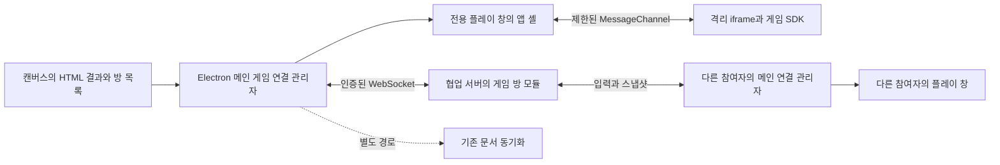

# HTML 공동 플레이 구현 계획

작성일: 2026-10-15. 기준: Game Jam! `0.23.0` / `4cb6f0e`. 상태: **추천 제품 정책 채택, 초기 구현 및 로컬·패키지 검증 완료. 운영 적용·외부망 검증 전**.

근거와 대안 비교는 [조사 문서](HTML_MULTIPLAYER_RESEARCH_2026-10-15.md)에 있다. 본문은 구현을 위한 설계 기준이며, 실제 구현 범위와 검증 결과는 [사용 안내·검증 기록](HTML_MULTIPLAYER.md)을 기준으로 확인한다. 설계에 있는 모든 항목이 완료됐다는 뜻은 아니다.

사용자는 2026-10-15에 추천안으로 구현 시작을 요청했다. **2~4인 협동 우선, 혼자 플레이와 멀티 모두 지원**을 채택하고 로컬 독립 앱·Windows 패키지 검증을 진행했다. 아래 검토 당시의 미결정 표는 당시 기록이며 현재 사용자 선택 대기 상태가 아니다.

2026-10-15 사용자 제안을 반영해, 제작 단계의 진입점을 **기능 라이브러리의 실제 적용 가능한 온라인 멀티플레이 모듈**로 변경한다. 이전 안의 결과 설정 내 별도 플레이 방식 선택은 두지 않는다. 완성 후의 방 생성·참가는 HTML 결과에서 제공한다.

## 1. 목표와 기본 결정

같은 공동 프로젝트의 참여자가 HTML 결과에서 방을 만들고, 다른 참여자가 참가해 각자 조작하면서 같은 게임 상태를 보는 기능을 만든다. 별도 포트 설정이나 게임별 서버 설치를 참가자에게 요구하지 않는다.

| 항목         | 첫 구현의 결정                                                                             |
| ------------ | ------------------------------------------------------------------------------------------ |
| 참여 대상    | 기존 프로젝트 인증을 가진 데스크톱 앱 사용자                                               |
| 인원         | 게임이 선언한 최소·최대 인원, 범위는 2~4명, 기본 2명                                       |
| 방 생성      | 관리자·편집자. 뷰어는 기존 방 참가·플레이 가능                                             |
| 결과 판정    | 방장 HTML이 게임 규칙을 계산. 서버는 방 수명·권한·전달 순서를 관리                         |
| 통신         | Electron 메인 ↔ 같은 협업 서버 포트의 WebSocket, `ws` 사용                                 |
| 실행         | 앱의 전용 공동 플레이 창 안에 격리 iframe                                                  |
| 게임 상태    | 메모리에 최신 스냅샷 보관. 프로젝트 파일·편집 히스토리에 틱을 저장하지 않음                |
| 코드 버전    | 방 생성 시 서버 HTML 바이트와 실행 계약을 고정                                             |
| 단절         | 참가자는 짧은 재접속, 방장은 일시 중단 후 복구 또는 판 종료                                |
| 첫 제외 범위 | 중도 신규 참가·관전·공개 매칭·브라우저/모바일·자동 방장 승계·서버 판정·게임 진행 영구 저장 |

이는 팀 내부 플레이 테스트용 기본안이다. 방장에게 게임 판정을 맡기므로 공개 경쟁의 공정성이나 부정행위 방지를 보장하지 않는다. 특정 버전 번호나 개발 기간은 기술 실험 통과 전에 확정하지 않는다.

## 2. 사용자 흐름

1. `gamejam! → 기능 라이브러리 → 멀티플레이·협동`에서 `프로젝트 온라인 멀티플레이` 모듈을 연다. 2~4인 범위를 설정하고 `게임에 추가`를 누른다. 선택한 게임 기능을 조합하는 기존 제작 흐름에 연결한다.
2. AI 생성이 완료되면 일반 HTML 미리보기와 `함께 플레이` 기능을 제공한다. 지원 선언이 없는 기존 HTML에는 수정 생성 안내를 제공한다.
3. `함께 플레이`에서 해당 결과의 방 목록을 보거나 새 방을 만든다. 방은 프로젝트 ID와 HTML 결과 식별자로 구분하고 표시 이름·버전·현재 인원을 보여준다.
4. 방 생성·참가 시 **공동 플레이 전용 창**을 연다. 생성 HTML에는 방 관리 UI를 만들게 하지 않고 앱 셸에서 닉네임·준비·시작·연결 상태를 제공한다.
5. 참가자의 HTML 및 SDK 초기화 확인이 끝나면 준비할 수 있다. 전원이 준비하고 최소 인원을 만족하면 방장이 시작한다.
6. 각자 입력하고 공통 상태를 본다. 플레이 중 AI가 새 결과를 만들어도 창의 실행 버전은 유지한다.
7. 종료 후 같은 방에서 다시 준비해 새 판을 시작할 수 있다. 새 판에는 새 `matchId`와 난수 seed를 부여한다. 다른 HTML 버전을 사용하려면 새 방을 만든다.

프로젝트가 로컬이거나 서버가 구형이면 이유와 필요한 다음 행동을 표시한다. 로컬 테스트는 기존 내장 서버로 공동 프로젝트를 만든 뒤 독립 테스트 사용자 창을 활용한다. 버튼이 보이는 것만으로 실제 연결 성공으로 처리하지 않는다.

### 라이브러리에서의 표시와 적용

현재 라이브러리에는 이미 `멀티플레이·협동` 분류와 방 만들기·준비·위치 동기화 같은 예시가 있다. 이 분류를 활용하고 같은 이름의 분류를 새로 만들지 않는다. 그 안에 공통 실행 기반을 제공하는 모듈 하나를 추가한다.

- 모듈 상세에는 `게임에 추가`, 인원 설정, 기본 포함 기능을 표시한다. 방 만들기·참가·준비·시작/종료·상태 동기화·연결 상태 안내는 한 모듈의 구성으로 제공한다. 기본 동작에 필요한 항목을 사용자가 하나씩 조립하게 하지 않는다.
- 단순히 폴더나 상세를 열어 보는 동작은 적용으로 처리하지 않는다. `게임에 추가` 후 `이번 구현에 포함` 목록과 최종 확인에 모듈·인원을 표시한다. 제거하면 멀티 생성 계약도 해제하며, 사용자가 쓴 작업 지침은 보존한다.
- 실제 구현된 항목에는 `사용 가능`, 현재 열람용 항목에는 `기능 예시`를 표시한다. 현재의 전체 `미리보기` 표제와 `현재 기능 선택은 HTML 구현에 반영되지 않습니다` 안내는 각 항목의 상태에 맞게 조정한다. 기능 예시를 선택한 것까지 실제 적용됐다고 보이지 않게 한다.
- 기존 `선택한 기능`의 열람용 목록과 실제 적용 모듈을 명확히 구분한다. 실제 모듈 설정은 부모 요청 상태에 보관하고 페이지 이동·닫기 후 초안 복구·최근 요청 불러오기에서도 복구한다. 컴포넌트 내부 `selectedIds`에만 보관하지 않는다.
- 모듈·인원 오류는 공통 요청 검증에 포함하고 `gamejam-wizard.ts`의 오류 페이지 매핑을 4단계 라이브러리로 연결한다. 최종 확인의 오류 링크를 누르면 해당 설정과 오류를 바로 볼 수 있게 한다.
- 같은 키보드 2인 같은 로컬 플레이 예시를 선택해도 온라인 모듈을 자동 적용하지 않는다. 장르별 추천 조합도 실제 모듈의 추가는 사용자가 확인할 수 있는 동일한 동작을 거친다.
- 앱이나 서버가 해당 계약을 지원하지 않으면 모듈에 이유를 표시하고 실행 전에 차단한다. 로컬에서 지원 앱으로 HTML을 생성할 수는 있지만 실제 공동 플레이에는 공동 프로젝트 연결이 필요하다는 안내를 둔다.

기능 라이브러리는 어떤 기능을 넣어 게임을 만들지 정하는 곳으로 사용하고, 실제 방 관리와 플레이는 완성된 HTML의 `함께 플레이`에서 수행한다. 라이브러리 안에 실행 중 게임 화면이나 프로젝트 방 관리까지 넣지는 않는다.

## 3. 구성과 책임



- 서버의 게임 방 모듈은 `getProjectAccess()` 등 읽기 인터페이스와 권한·프로젝트 수명 변경 통지만 받는다. 프로젝트 DB 전체 객체를 직접 수정하지 않는다.
- 방의 입력·상태 처리에는 기존 `persist()`, `recordChanges()`, 문서 저장 큐와 프로젝트 리비전을 사용하지 않는다. 같은 프로세스를 공유하는 CPU·이벤트 루프 비용은 남으므로 크기·빈도를 제한하고 함께 부하 검사한다.
- 메인 게임 연결 관리자는 프로젝트 세션을 사용하되 문서 요청의 직렬 큐·오프라인 큐에 플레이 데이터를 넣지 않는다. 소켓과 참가 정보는 프로젝트·창 수명에 결속한다.
- 플레이 창의 preload는 게임 전용 최소 API만 제공한다. 기존 전체 `GameCanvasApi`를 복사하지 않는다. 메인 창은 방 목록·방 생성 등의 낮은 빈도 명령만 호출한다.
- 생성 HTML은 게임 SDK만 사용한다. 프로젝트 토큰, 초대 코드, 관리자 복구 키, 임의 네트워크 전송 API를 받지 않는다.

## 4. 게임 결과 식별과 고정

방 생성 요청은 HTML 경로와 클라이언트가 알고 있는 SHA-256을 보낸다. 서버는 자신의 최신 파일을 검증해 읽고 해시가 일치할 때만 메모리에 고정한다. 불일치하면 최신 결과를 확인하도록 응답한다. 클라이언트가 보낸 HTML을 서버 결과로 채택하지 않는다.

고정 대상은 UTF-8 원본 HTML, 원본 SHA-256, 지원 선언, `sdkVersion`, `sdkBuildHash`다. `artifactId`는 이 값들의 정해진 직렬화에 대한 해시로 정의한다. 창별 연결 ID나 키보드 브리지는 원본 해시에 포함하지 않는다. 실제 iframe에는 고정된 소스와 해당 SDK만 사용한다.

참가 앱은 방에 고정된 원본을 인증된 API로 받아 해시를 검사한다. 자신의 최신 프로젝트 파일이 변경됐더라도 방의 사본으로 실행한다. 지원 SDK 빌드가 없으면 조용히 최신 SDK로 대체하지 않고 앱 업데이트를 안내한다. 방 목록에 HTML 본문·인증 정보를 넣지 않는다.

첫 지원 결과는 CSS·게임 JS·사용 에셋이 들어 있는 단일 HTML이다. 정적 참조 검사를 재사용해 외부 스크립트·CDN·별도 로컬 파일 의존성이 있는 결과는 방 생성을 거절한다. 런타임 검증에서도 네트워크 차단 상태로 확인한다. 외부 URL 참조를 모두 정적으로 탐지할 수 있다는 보장은 하지 않는다.

원본의 수정·이동·삭제는 이미 실행 중인 방의 사본을 바꾸지 않는다. 삭제·이동된 결과에는 신규 방 생성을 허용하지 않고 기존 방은 프로젝트 전체 방 목록에서 접근 가능하게 한다. 단, 프로젝트 휴지통·권한 회수는 게임 방도 종료한다. 마지막 참조가 사라지면 고정 소스 메모리를 해제한다.

## 5. HTML 실행 계약과 SDK

### 5.1 지원 선언

HTML 안에 실행하지 않는 `<script type="application/json" id="gamejam-multiplayer">` 선언을 둔다. 첫 제안 필드는 다음과 같다.

```json
{
  "version": 1,
  "sdkVersion": 1,
  "authority": "host",
  "minPlayers": 2,
  "maxPlayers": 4,
  "stateVersion": 1
}
```

중복 선언·잘못된 값·과도한 길이를 거절하고 선언만으로 지원 완료로 판정하지 않는다. 앱이 제공한 SDK를 예약 전역 `GameJamMultiplayer`에 게임 스크립트보다 먼저 설치한다. HTML 파서로 삽입하며 단순 문자열 끝 덧붙이기를 사용하지 않는다. SDK를 AI가 재구현하거나 임의 버전으로 바꾸게 하지 않는다.

앱 밖에서 열면 SDK 존재를 검사해 이용 안내를 표시하거나 별도로 구현한 싱글플레이로 진입한다. 외부 앱이나 브라우저에서 멀티플레이가 바로 작동한다고 설명하지 않는다. 앱은 원본 HTML 파일에 인증 정보·창별 연결 정보를 저장하지 않는다.

### 5.2 게임 어댑터

아래는 동작 계약을 설명하는 제안이다. 최종 타입은 기술 실험에서 확정한다.

```ts
GameJamMultiplayer.register({
  createState({ players, seed }) {
    /* 방장만 초기 상태 생성 */
  },
  validateInput(input) {
    /* 게임 입력의 형태와 범위 검사 */
  },
  step(state, { inputs, dt, players }) {
    /* 방장만 공통 판정 */
  },
  render(state, { selfId, interpolation }) {
    /* 모두 화면 표시 */
  },
  getOutcome(state) {
    /* 진행 중 null, 종료 시 결과 반환 */
  },
});
// 실제 키 입력은 SDK의 sendInput(payload)으로 전달한다.
```

- `createState`·`step`은 DOM 없이 공통 상태를 계산한다. `requestAnimationFrame`은 그리기에만 사용한다. SDK가 고정 간격 계산과 스냅샷 발행을 관리한다.
- 어댑터의 상태 계산은 동기 함수로 제한한다. `render`는 상태를 수정하지 않는 표시 함수로 다루고 방장도 표시용 사본을 사용한다. PRNG의 현재 상태, 시뮬레이션 시각·틱, 입력 처리 순번은 SDK 스냅샷 메타데이터에 포함해 방장 복구 때 함께 되돌린다.
- 방장만 적·투사체·피해·아이템·점수·승패를 확정한다. 참가자는 로컬에서 같은 효과를 다시 공통 상태에 반영하지 않는다.
- 초기 상태와 무작위 이벤트는 seed 기반 PRNG를 사용한다. 모든 참가자의 완전한 결정론을 전제로 하지 않으며 재접속은 최신 스냅샷으로 복구한다.
- 입력은 키 상태와 일회성 동작을 구분한다. 서버가 붙인 플레이어 ID·연결 ID·순번을 사용하고 클라이언트의 닉네임·ID 주장을 신뢰하지 않는다. 방장은 최근 처리 순번으로 중복을 거른다.
- 흐려짐·포커스 상실·연결 단절 시 눌린 키를 해제한다. 마지막 입력이 일정 시간 갱신되지 않으면 중립 입력으로 바꿔 계속 이동하는 현상을 막는다.
- SDK는 에러·판정 중단을 앱에 보고한다. 타임아웃으로 동기 무한 루프를 항상 중단할 수 있다고 가정하지 않는다. 응답 없는 플레이 렌더러를 메인이 감지하면 해당 창을 종료하고 방 수명 규칙을 적용한다.
- 서로 다른 게임의 상태는 제한된 JSON 값으로 전달한다. 함수·DOM·프로토타입을 전달하거나 수신 데이터를 객체 설정에 임의 병합하지 않는다. 깊이·항목 수·문자열·바이트 수·유한 숫자 여부를 검사한다.
- `getOutcome`이 결과를 반환하면 방장 SDK가 최종 스냅샷과 연결된 `finish`를 보낸다. 서버는 현재 방장·판·상태 순번을 확인하고 한 번만 `finished`로 전환한다. 다른 참가자의 종료 요청이나 중복 종료가 다음 판을 끝내지 못하게 한다.

### 5.3 실행 창과 브리지

전용 창은 신뢰하는 앱 셸만 로드하고 그 안의 iframe에 생성 HTML을 넣는다. `nodeIntegration: false`, `contextIsolation: true`, `sandbox: true`와 기존 iframe sandbox를 유지한다. 앱 관리 API는 게임 iframe에 노출하지 않는다.

전용 창은 분리된 session을 사용하고 렌더러의 HTTP/HTTPS/WS/WSS 요청을 차단한다. 앱 셸의 패키지 리소스와 허용한 data/blob 에셋만 로드하고 프레임 탐색·팝업을 차단한다. 생성 HTML의 내장 `fetch`·WebSocket으로 앱 브리지를 우회하지 못하게 하며 메인 프로세스의 게임 소켓은 이 session을 사용하지 않는다. 실제 에셋·오디오·포인터 잠금 호환성은 패키지 검사에 포함한다.

초기 연결은 등록된 iframe의 `contentWindow`와 실행별 난수 ID를 검사하고 전용 MessageChannel을 전달한다. 이후 허용된 게임 메시지만 포트로 처리한다. iframe 로드·탐색·창 종료 시 이전 포트를 폐기하고 다시 결속한다. 메시지에 방 ID를 써서 다른 방으로 바꿀 수 없도록 방 결속 정보는 메인이 관리한다.

메인 IPC는 등록된 캔버스 메인 프레임 또는 해당 플레이 창 메인 프레임만 허용한다. 두 종류의 허용 명령을 분리한다. 다른 창·iframe·검증용 창의 호출을 차단한다. `event.origin === 'null'`만으로 허용하지 않는다.

방장 전용 창에만 `backgroundThrottling: false`를 적용하는 안을 먼저 검증한다. 카드 접기와 캔버스 변경은 이 창에 영향을 주지 않는다. 방장 계산은 고정 dt, 한 번에 최대 5회 따라잡기를 출발점으로 삼고 긴 중단 후 수백 프레임을 일괄 계산하지 않는다. 최소화·다른 앱 가림·복원 검사를 통과하지 못하면 구현을 넓히기 전에 스케줄러 또는 전용 실행 구조를 보완한다.

## 6. 서버와 프로토콜

### 6.1 진입점

| 경로·채널                               | 역할                                                    | 필수 조건                                                   |
| --------------------------------------- | ------------------------------------------------------- | ----------------------------------------------------------- |
| 기존 `/health`와 협업 상태              | `multiplayerVersion: 1`, 지원 SDK 빌드 목록·제한 제공   | 기능 협상. 누락은 미지원                                    |
| `POST /projects/:id/play`               | `list/create/join/leave/ready/start/stop/artifact` 제어 | 기존 Bearer 인증, 현재 프로젝트 상태 확인, 동작별 권한 검사 |
| `GET /projects/:id/play-socket` Upgrade | 연결 뒤 `attach/input/snapshot/resync/finish` 등 전달   | HTTP 핸들러와 별도로 경로·Origin·인증·한도 검사             |
| 새 `multiplayer:*` IPC                  | 앱 셸과 메인 연결 관리자                                | 등록된 sender·프레임·프로젝트 세대 확인                     |

Electron 메인의 `ws` 클라이언트가 Upgrade의 Authorization 헤더에 기존 세션 토큰을 보낸다. 토큰은 URL·query·HTML·렌더러·로그에 넣지 않는다. 이 경로는 브라우저 직접 접속을 지원하지 않으므로 기존 HTTP의 Origin 차단을 풀 필요가 없다. 리다이렉트는 거부하고 HTTP/HTTPS의 기존 서버 주소 정책을 WS/WSS로 대응시킨다.

게임 제어 HTTP는 기존 문서 action 분기와 프로젝트 변경 큐에 진입하기 전에 별도 디스패치한다. 높은 빈도의 포트·소켓 메시지는 기존 범용 `handle()`의 변경 직렬화 경로를 통과시키지 않는다. 방 제어의 원자성은 방 전용 처리로 보장하고, 프로젝트 권한 변경 확정과 경합하면 최신 권한으로 재검사한다.

방 목록은 다이얼로그가 열려 있을 때만 낮은 빈도로 조회한다. 플레이 창은 소켓으로 방 수명 변경을 받는다. 방 목록 변경 때문에 전체 파일·HTML·캔버스를 다시 읽지 않는다.

### 6.2 식별자와 검증

모든 플레이 메시지는 `protocolVersion`, `serverEpoch`, `roomId`, `matchId`, 메시지 종류와 순번을 갖는다. 방은 서버 시작마다 바뀌는 `serverEpoch`에 속하고 재시작 후 예전 방 ID를 복구하지 않는다. 로비 메시지에는 아직 없는 `matchId` 대신 로비 상태를 명시한다.

서버가 참가자·연결을 식별하고 입력을 방장에게만 보낸다. 스냅샷은 현재 방장 연결에서만 받아 최신 것으로 보관한 뒤 나머지 참가자에게 전달한다. `stateSeq`가 증가하지 않거나 이전 판의 메시지면 버린다. 소켓 attach 이후 다른 방의 ID를 넣어도 권한을 넓히지 않는다.

`create/join/ready/start/leave`는 `requestId`와 필요한 `expectedRoomRevision`을 사용한다. 같은 프로세스 내 응답 유실 재시도는 bounded dedup 캐시로 같은 결과를 반환한다. 서버 재시작 후 미확인 create/start를 자동 재실행하지 않고 `serverEpoch` 변경과 새 방 필요를 표시한다. 게임 입력에 제어 요청의 재시도 규칙을 적용하지 않는다.

인증 후에도 메시지 처리 시 현재 프로젝트 활성 상태·참여자 제외 여부·방 참가 여부·판 ID를 확인한다. 사용자 ID나 권한을 최초 연결 객체에만 복사해 두지 않는다. 권한·휴지통 변경 확정 시 관련 소켓에 종료 신호를 보내고 서버에서도 즉시 차단한다.

### 6.3 시작과 준비

서버는 HTML 다운로드·해시·SDK 초기화가 끝난 `loaded` 확인을 받은 자리만 준비할 수 있게 한다. 이후 방장이 시작을 요청하면 최소 인원·전체 준비·연결 상태를 다시 검사한다.

시작은 `loading → running` 장벽을 둔다. 모든 참가자가 같은 `artifactId`와 새 `matchId`를 확인하고 방장 초기 스냅샷을 받기 전에는 입력을 적용하지 않는다. 10초 안에 초기화가 끝나지 않으면 로비로 돌아가 준비를 해제하고 원인을 표시한다. 네트워크 시각이 같다는 가정으로 각자 게임을 독립 시작하지 않는다.

## 7. 방 수명·권한·단절 정책

| 상황                              | 동작                                                                                                                   |
| --------------------------------- | ---------------------------------------------------------------------------------------------------------------------- |
| 정상 상태                         | `lobby → loading → running → finished → lobby`; 새 판마다 새 match ID                                                  |
| 새 참가 요청                      | 로비에서 자리 있으면 허용. 진행 중 신규 참가 거절                                                                      |
| 일반 참가자 연결 단절             | 입력 즉시 중립화, 15초 자리 보존. 같은 프로젝트 참여자가 재접속하면 새 연결 세대로 교체하고 최신 스냅샷 수신           |
| 재접속 불가·자리 유예 만료        | 첫 버전은 남은 인원과 관계없이 해당 판 종료, 로비 복귀. 게임별 탈락·대체 규칙은 후속                                   |
| 방장 연결 또는 상태 진행 중단     | 3초 내 전체 일시 중단 표시·새 입력 차단. 15초 이내 동일 방장 복구 시 전체 스냅샷과 재개 장벽 후 진행, 실패하면 판 종료 |
| 복구한 방장 런타임                | 고정 artifact로 재초기화하고 서버가 보관한 마지막 스냅샷으로 복구. 모든 게임 진행 정보가 상태에 직렬화되어 있어야 함   |
| 마지막 발행 이후 방장 미확정 계산 | 마지막 수신 스냅샷까지로 복구할 수 있으며 짧은 되돌림이 있음을 연결 상태에 표시. 영구 저장 완료라고 표시하지 않음      |
| 방장 명시적 퇴장·창 닫기          | 방 종료. 자동 승계 없음. 창 닫기 동작에 결과를 명확히 표시                                                             |
| 일반 참가자 명시적 퇴장           | 자리 즉시 반납, 진행 중이면 판 종료 후 나머지는 로비                                                                   |
| 뷰어 전환                         | 이미 참가한 플레이는 유지하되 방 새 생성은 금지. 뷰어도 계속 플레이 가능                                               |
| 프로젝트 참여자 제외              | 자리·소켓·재접속 권한 즉시 회수. 방장이면 방 종료, 일반 참가자면 판 종료 후 로비                                       |
| 홈 복귀·프로젝트 전환             | 기존 플레이 연결·창을 정리. 다음 프로젝트에 소켓·포트를 재사용하지 않음                                                |
| 프로젝트 휴지통·영구 삭제         | 해당 프로젝트의 방·소켓·고정 소스 정리. 복원 후 새 방 생성 필요                                                        |
| 서버 재시작·종료                  | 모든 방 종료. 방 상태를 프로젝트 백업 복구 대상에 넣지 않음                                                            |

소켓 ping/pong과 게임 진행 검사는 분리한다. 소켓이 살아 있어도 방장 틱이 멈추면 중단한다. 반대로 문서 폴링 실패만으로 살아 있는 게임 소켓을 곧바로 닫지는 않되, 서버의 권한·수명 판정을 따른다. 복구 직후에는 과거 이동·공격 큐를 비우고 키를 다시 입력받는다.

서버 종료 시 새 Upgrade를 차단하고, 기존 WebSocket에 종료를 알린 뒤 제한 시간 후 남은 연결을 강제 종료한다. 기존 `server.closeAllConnections()`에 소켓 정리를 맡기지 않는다. 타이머·포트·방 메모리까지 해제한 뒤 DB 종료 등 기존 순서를 따른다.

## 8. 초기 자원 제한과 반응성

아래는 구현 시작값이며 동시 운영 가능 규모의 약속이 아니다. 모든 수치는 서버와 클라이언트가 함께 적용하고 `/health`의 제한 정보로 표시한다.

| 항목             | 제안 시작값                                                                           |
| ---------------- | ------------------------------------------------------------------------------------- |
| 한 방            | 최대 4자리, 프로젝트 참여자당 같은 프로젝트에서 활성 방 1개                           |
| 방 수            | 프로젝트당 2개, 서버 전체 8개, 실제 부하 결과로 낮출 수 있음                          |
| 방장 계산·렌더링 | 계산 30Hz, 화면은 별도 rAF, 스냅샷 최대 20Hz                                          |
| 입력             | 최대 30Hz, 순간 60개/초. 메시지 payload 1KiB 이하                                     |
| 스냅샷           | payload 32KiB 이하, 보통 2~8KiB 목표. 프레임 전체 한도 40KiB                          |
| 송신량           | 연결별 지속 수신 256KiB/초, 방별 송신 1MiB/초, 서버 전체 송신 8MiB/초부터 검토        |
| 송신 대기        | 연결당 256KiB 초과 시 새 상태 대기분을 최신 하나로 병합, 지속 2초 초과 시 재접속 처리 |
| 고정 HTML        | 파일별 기존 8,000,000바이트 이내, 서버 전체 고정 소스 합계 64MiB 이내                 |
| 재시도·하트비트  | 소켓 ping 2초, 상태 중단 3초, 재접속 유예 15초, backoff 0.5/1/2/4초에 jitter 적용     |
| 로비·종료 방     | 빈 방 즉시 해제, 활동 없는 로비 30분 정리, 종료 사유 최대 60초 보관 후 해제           |

30Hz의 1KiB 입력과 20Hz의 8KiB 상태는 대략 초당 190KiB 수신이므로 위 연결별 예산 안에 들어간다. 4명 방에서 4KiB 상태를 초당 20회 보내고 방장 외 3명에게 전달하면 서버 송신은 약 240KiB/초다. 프레이밍·제어 메시지·문자열 메모리 비용은 별도다. 최대 상태 크기와 최대 빈도를 항상 동시에 허용하지 않고 바이트 예산으로 추가 제한한다.

이미 전송 중인 TCP 데이터는 제거할 수 없으므로 앱 내부 대기열만 합친다. 입력 상태도 최신 값으로 합칠 수 있지만 이미 확정된 제어 응답·방 종료·권한 회수는 임의로 버리지 않는다. 일회성 입력은 크기가 제한된 큐와 순번을 사용하며 단절 시 재생하지 않는다. 상태 크기 초과 시 잘라서 서로 다른 상태를 배포하지 않고 오류·중단을 표시한다.

## 9. AI 생성 파이프라인 연결

실제 실행 설정을 `GamejamRequest`, `CreateTaskInput`, `thenImplement`, 저장 요청·초안·히스토리, 작업 명세에 전달한다. `multiplayer: { version: 1, authority: 'host', minPlayers, maxPlayers, sdkVersion }` 같은 명시적 필드를 사용한다. 새 게임에서 모듈 미지정은 개인 플레이로 해석한다. 기존 게임 수정에서는 기존 선언을 먼저 읽어 적용 상태를 복구한다. 과거 요청에 필드가 없다는 이유만으로 멀티를 제거하지 않는다.

라이브러리의 실제 모듈 추가·설정·제거는 이 `multiplayer` 필드를 변경하는 단일 경로로 연결한다. 별도 결과 설정의 토글이나 열람용 `selectedIds`를 두 번째 원본으로 만들지 않는다. 기존 카탈로그의 모든 예시 ID를 작업 지침에 넣는 방식으로 바꾸지 않고, 지원 모듈의 버전·설정만 검증해 전달한다. 첫 모듈의 연결에 필요한 최소 구조부터 만들고 다른 기능 전체의 실행 모듈화는 별도 범위로 둔다.

공동 프로젝트에서는 서버의 기능 지원을 확인하고 미지원이면 실행 전에 안내한다. 구형 작업 실행 앱이 필드를 무시하고 개인 플레이 결과를 게시하지 않도록 작업 claim과 결과 반영 양쪽에서 실행 계약 지원을 검사한다. 문서 정리 후 구현하는 두 단계에서도 같은 계약을 유지한다.

작업 지침에 SDK 타입·실행 가능한 최소 예제·입력과 판정 분리·직렬화 가능한 상태·단절 복구·플레이어별 조작·승패 전이를 제공한다. 전용 서버 코드를 생성하거나 HTML 안에 서버 주소·토큰을 하드코딩하게 하지 않는다. 결과 형식·보호 경로·원자적 게시 등 기존 계약을 유지한다.

검증은 세 층으로 나눈다.

1. 정적 검사: 선언, 계약 버전, 지원 인원, 크기, 어댑터 등록 구조, 금지 참조를 확인한다. 단순 문자열 존재만으로 통과시키지 않는다.
2. 기존 초기 실행: 현재 오프라인 `validateHtml` 경로를 유지하면서 해당 SDK의 검증 모드를 주입한다. 서버 미연결을 정상 대기 상태로 다루고 코드 오류는 기존처럼 거절한다.
3. 공동 실행: 실제 서버와 격리된 2~4개 게임 컨텍스트에서 어댑터 초기화·입력 처리·공유 상태 직렬화·단절 복구를 검사한다. 생성 게임에는 테스트용 입력 fixture와 상태 요약 계약을 요구하고, 게임이 실제 조작·목표를 올바르게 구현했는지는 플레이 확인도 수행한다.

공동 실행의 기술 검사는 생성 결과 반영 전의 필수 검증으로 구현한다. 게임 의미에 대한 자동 검사는 제한이 있으므로 단순 초기화 성공을 `멀티플레이 검증 완료`로 표시하지 않는다. 검증 실패 시 기존 결과·방을 보존하고 새 결과는 반영하지 않는다. 유료 AI 호출은 자동 회귀 검사에 포함하지 않는다.

기존 멀티 결과를 수정할 때는 기준 HTML에서 복원한 모듈·인원을 최종 확인에 표시하고 기본적으로 유지한다. 라이브러리에서 사용자가 실제 모듈을 제거한 경우에만 제거 의도를 요청에 명시한다. 요청 정규화 단계에서 유지/추가/제거를 해석한 뒤 최종 실행 계약 하나로 전달한다. 기능 제거는 다음 생성 결과에만 반영하고 원본 파일이나 진행 중인 방을 즉시 변경하지 않는다. 멀티 코드를 지우는 것만으로 싱글플레이 게임이 완성된다고 가정하지 않는다.

문서 정리만 실행하는 경우에는 모듈 설정을 작성 중 초안에 보관하되 HTML 실행 계약을 활성화하지 않는다. `HTML 구현을 선택하면 적용됩니다`라고 표시하고 유료 AI 실행 단계를 자동 추가하지 않는다. 기존 멀티 HTML을 문서로 분석할 때는 실제 구현을 분석하며, 라이브러리 선택을 이미 구현된 사실로 쓰지 않는다.

## 10. 구현 작업 순서와 완료 조건

### P0. 위험 검증용 최소 연결

- 합성 프로젝트·서버와 수작업 2인 이동/공동 아이템 획득 게임을 만든다. 운영 데이터나 실행 중 호스트는 건드리지 않는다.
- 최소한의 `ws` Upgrade 인증, 전용 플레이 창, opaque iframe MessageChannel, SDK 어댑터를 연결한다.
- 실제 패키지에서 방장 최소화·가림·복원 60초, 무관한 캔버스 편집, 소켓 재연결, 2개 창의 상태 수렴을 확인한다.
- 외부 터널 WebSocket은 별도 합성 서버/터널로 검사한다. 실제 운영 경로 검증이 필요한 때에도 진행 중 세션을 임의 재시작하지 않는다.

**완료 조건:** 동일 버전의 독립 2개 앱이 입력·상태를 주고받고 아이템을 한 번만 획득한다. 방장 최소화가 무통보 게임 정지로 이어지지 않는다. 실패하면 원인을 해결하거나 실행 구조를 수정한 뒤 P1로 간다.

### P1. 서버 방과 프로토콜

- 게임 타입·검증기, 메모리 방 저장소, HTTP 제어, 소켓 attach, 입력/상태 순번과 자원 제한을 구현한다.
- 회원 제외·프로젝트 휴지통·종료와 연결하고 서버 종료·타이머 정리를 구현한다.
- 방 생성·참가 경합·시작 장벽·중복 요청·다른 프로젝트 침범·진행 중 참가 거절을 검증한다.

**완료 조건:** 프로토콜을 잘못 사용해도 다른 방·문서 상태를 바꾸지 못하고, 문서 리비전/히스토리가 게임 틱 때문에 증가하지 않는다.

### P2. 앱 연결 관리자와 전용 실행 창

- 프로젝트 세션을 사용하는 별도 메인 클라이언트와 제한 preload, 앱 셸, SDK 주입·포트 결속을 구현한다.
- 고정 HTML 수신·해시·SDK 빌드 확인, reconnect·상태 복구·키 해제를 구현한다.
- 전용 창 렌더러/프리로드 엔트리를 Forge·Vite 빌드에 추가하고 설치본에서 경로·sandbox·실행을 확인한다.

**완료 조건:** 캔버스 갱신·접기·AI 결과 변경과 독립적으로 플레이가 유지되고 프로젝트 전환·창 종료 시 이전 연결이 남지 않는다.

### P3. 방 UI와 다중 사용자 기준 게임

- HTML 창의 함께 플레이 진입점, 프로젝트의 활성 방 목록, 로비·준비·시작·지연/단절·종료 안내를 구현한다.
- 관리자·편집자·뷰어 권한, 구형 서버·구형 SDK·로컬 프로젝트 안내를 구현한다.
- 수작업 기준 게임으로 2인·4인, 동시 아이템 획득, 재시작·점수·승패·재접속을 통과시킨다.

**완료 조건:** 기존 테스트 사용자 실행 기능으로 별도 프로필들이 참가하고, 사용자가 서버 주소나 키를 게임 안에 입력하지 않고 함께 플레이한다.

### P4. AI 생성 계약·검증·기존 게임 수정

- 기능 라이브러리의 기존 멀티플레이 분류에 실제 모듈을 추가하고 사용 가능/기능 예시 표시, 게임에 추가·설정·제거, 최종 확인을 연결한다.
- 요청·두 단계 명세·초안·재실행·히스토리·서버 기능 협상에 설정을 연결한다.
- SDK 참조 예제와 검증 모드, 공동 실행 하네스를 완성한다. 기존 HTML은 원본을 보존한 새 버전 수정 생성부터 지원한다.
- 자동 검증은 AI 대역/고정 fixture로 수행하고 생성 HTML의 실제 의미·조작은 별도 플레이 기록으로 남긴다.

**완료 조건:** 개인 플레이 회귀 없이 새 멀티 결과를 생성·검증·공유하고, 실패·필드 누락·미지원 실행자는 결과 게시 전에 차단한다.

### P5. 인터넷·패키지·편집 병행 검증

- 4개 독립 프로필·실제 패키지 창, 2개 게임 방, 무관한 문서 편집·AI fixture 반영을 병행한다.
- 서로 다른 PC·망에서 실제 참여자가 접속해 시작부터 종료·재접속까지 확인한다. 같은 PC 다중 창과 외부 터널 왕복 결과와 구분해 기록한다.
- 방 수·입력·상태 크기를 늘리며 CPU·메모리·대기 바이트·문서 저장 응답을 측정하고 기본 상한을 확정한다.

**완료 조건:** 아래 수용 기준을 만족하고 실제로 검증한 네트워크·인원·상태 크기를 문서에 기록한다. 물리적으로 다른 PC를 검사하지 못했다면 그 항목은 미완료로 남긴다.

선행 관계는 `P0 → P1 → P2 → P3 → P4 → P5`다. 수동 기준 게임이 먼저 통과해야 AI 결과에서 네트워크·게임 규칙 문제를 구분할 수 있다. 이후 배포는 별도 작업으로 진행한다.

## 11. 변경 파일 지도

| 영역       | 기존 연결 지점                                                                                                                           | 제안 신규 모듈·수정                                                                                          |
| ---------- | ---------------------------------------------------------------------------------------------------------------------------------------- | ------------------------------------------------------------------------------------------------------------ |
| 라이브러리 | `src/ui/GameFeatureLibrary.tsx`, `src/game-feature-catalog.ts`, `src/ui/App.tsx`                                                         | 실제 모듈 설명·인원 설정·추가/제거·상태 구분·부모 요청/최종 확인 연결. 기존 예시는 열람용 유지               |
| 계약       | `src/shared.ts`, `src/app-errors.ts`                                                                                                     | `src/multiplayer/types.ts`, `protocol.ts`, `artifact.ts`, `validation.ts`; `GC-MP-*` 오류 체계               |
| 서버       | `src/collaboration-server.ts`                                                                                                            | `src/multiplayer/server.ts`, `rooms.ts`, `limits.ts`; 인증·lifecycle hook·종료 연결                          |
| 메인 통신  | `src/main.ts`, `src/collaboration-client.ts`                                                                                             | `src/multiplayer/client.ts`, `window-manager.ts`; credentials는 메인에서만 주입                              |
| 앱 셸·격리 | `src/preview-permissions.ts`, `src/preview-window.ts`                                                                                    | `src/multiplayer/preload.ts`, `player-entry.tsx`, `sdk.ts`, `bridge.ts`; 제한된 권한 재사용                  |
| 방 UI      | `src/ui/App.tsx`, 기존 협업·업데이트 UI                                                                                                  | `src/ui/MultiplayerLobby.tsx`, `src/ui/MultiplayerPlayer.tsx`; 프레임 데이터는 React 전역 상태로 돌리지 않음 |
| 생성       | `src/gamejam-request.ts`, `gamejam-validation.ts`, `gamejam-history.ts`, `task-plan.ts`, `task-specification.ts`, `task-instructions.ts` | 라이브러리 적용 설정·저장/복구·두 단계 전달·공통 예제·실행자 기능 협상                                       |
| HTML 검사  | `src/html-document.ts`, `src/html-validation.ts`, 기존 참조 분석                                                                         | `src/multiplayer/generated-validation.ts`; SDK 초기화·공동 실행 검사                                         |
| 빌드       | `package.json`, `package-lock.json`, `forge.config.mts`, Vite 설정, 서버/호스트 런타임 빌드                                              | `ws`와 타입, 전용 창 빌드 엔트리, 서버·설치본 포함 확인                                                      |
| 검증       | `tests/`의 협업·네이티브 창·패키지 패턴                                                                                                  | `multiplayer*.test.mjs`, Electron·패키지 실행기, 고정 기준 게임 fixture                                      |

파일 경로는 역할 제안이며 기존 모듈 분리 규칙에 맞게 구현 시 조정할 수 있다. 단일 `App.tsx`나 기존 서버의 거대한 분기에 게임 루프까지 추가하는 형태는 피한다.

## 12. 검증 행렬과 수용 기준

| 검사            | 반드시 확인할 결과                                                                                                                                                    |
| --------------- | --------------------------------------------------------------------------------------------------------------------------------------------------------------------- |
| 라이브러리 적용 | 열람만으로 적용되지 않음. 모듈 추가·인원 수정·제거가 요청/최종 확인에 일치하고 초안·히스토리에서 복구됨. 기존 예시 선택과 로컬 2인 선택이 온라인 적용으로 바뀌지 않음 |
| 계약·순번       | 잘못된 선언·NaN·깊은 JSON·대형/분할 메시지·예전 판·예전 연결·중복 요청 거절. 상태 일부분만 적용하지 않음                                                              |
| 권한            | 비회원·다른 프로젝트·회수 토큰 거절. 뷰어 참가 가능/방 생성 금지. 참가자가 방장 상태를 발행하지 못함                                                                  |
| 방 경합         | 마지막 자리 동시 참가·동시 시작·초기화 실패·중복 소켓에서 일관된 결과. 준비/시작 장벽 유지                                                                            |
| 상태 판정       | 동시 아이템 획득 시 1회 보상, 공동 적 체력·점수·승패 일치. 난수 결과·타이머도 스냅샷으로 복구                                                                         |
| 연결 단절       | 이동 중 끊기면 키 해제. 재접속 후 과거 공격 재실행 없음. 최신 상태로 수렴하고 방장 단절은 모두 중단·재개 또는 종료                                                    |
| 실행 수명       | 최소화·가림·포커스 이동·전체 화면·캔버스 변경·AI 결과 갱신 시 사본 유지. OS 절전 후 무한 따라잡기 없음                                                                |
| 격리            | iframe·다른 창·검증 창의 IPC 차단. 다른 방 포트 재사용 불가. HTML/로그/URL에서 프로젝트 토큰 검출 없음                                                                |
| 자원            | 과다 입력·느린 수신자·대형 상태를 제한하고 대기 메모리가 계속 증가하지 않음. 방 종료 반복 뒤 소켓·타이머·소스 해제                                                    |
| 기존 기능       | 개인 HTML·문서 저장·잠금·히스토리·오프라인 편집·AI 원자적 반영 유지. 플레이 데이터가 문서 거래/캐시에 들어가지 않음                                                   |
| 실제 배포 형태  | 설치 패키지의 독립 프로필 2~4개와 내장/별도 서버 번들 양쪽에서 동작                                                                                                   |
| 실제 인터넷     | 합성 프로젝트의 터널 왕복과 다른 PC·망 참여자의 검사 결과를 분리. 로컬 검증을 원격 확인으로 보고하지 않음                                                             |

성능 실험의 시작 목표는 4명·상태 8KiB 이하·스냅샷 20Hz에서 30분 동안 메모리/대기열이 계속 늘지 않는 것이다. 연결별 RTT 100ms와 지터 20ms를 주입한 조건에서 입력부터 원격 화면 표시까지 p95 500ms 이하를 초기 목표로 둔다. 이는 왕복이 방장을 거치는 구조와 보간을 포함한 제안값이며 장르 전체의 쾌적함을 보장하지 않는다.

같은 문서 작업량의 게임 미실행 기준과 비교해 문서 저장 p95 악화 20% 이내를 목표로 측정하고, 초과하면 게임 자원 상한·메시지 처리·별도 프로세스 분리를 검토한다. 네트워크 프레임 지연·연결 종료 주입은 실제 TCP 손실/재전송을 완전히 재현하지 않으므로 결과를 구분한다. 실제 지연이 큰 경우엔 통신/판정 구조를 바꾸거나 지원 장르·범위를 좁혀야 한다.

자동 검증은 타입 검사·린트·네트워크 단위 검사를 가능한 한 병렬로 실행한다. 같은 출력 폴더를 쓰는 서버 빌드·패키지 빌드·UI 검사는 순서를 둔다. 문서만 작성한 이번 단계에서는 앱 테스트 통과나 실제 플레이 성공을 주장하지 않는다.

## 13. 배포·문서화 시 지킬 사항

구현 후 앱·내장 서버·별도 서버·호스트 런타임의 기능 버전을 함께 확인한다. 미지원 앱·서버에는 명확한 안내를 제공하고 일반 개인 플레이는 유지한다. 사용 안내에는 인원, 방장 역할, 단절/재접속, 고정 버전, 브라우저 미지원 범위를 적는다.

실제 배포가 요청되면 [UPDATES.md](UPDATES.md)의 릴리스 게시 순서와 [AGENTS.md](AGENTS.md)를 따른다. 같은 소스의 빌드·필수 검증은 한 번 수행하고 검증한 결과물을 게시한다. 패키지가 이미 준비됐다면 동일 소스·설정·대상임을 확인해 재사용한다. 의존성·서버 번들·Node 캐시도 유효성을 확인해 재사용한다.

공개 자산의 해시·크기·다운로드 접근·RELEASES를 확인하고, 배포 파일 게시 완료와 자동 업데이트 피드 반영 완료를 구분한다. 운영 서버 재시작과 진행 중 플레이 방 종료는 사용 중인 세션을 확인한 뒤 별도 배포 절차에 포함한다. 이 계획 작성 과정에서는 배포·운영 전환을 수행하지 않는다.

## 14. 구현 전 결정 검토 · 2026-10-15

이번 검토는 기존 코드·설계의 누락과 상충을 점검한 것이다. 사용자 선택이 필요한 제품 항목과 구현자가 정할 수 있는 기본 동작을 구분한다. 아래 추천안은 아직 사용자 선택을 받은 것으로 취급하지 않는다.

### 사용자 선택을 요청한 두 항목

| 항목              | 추천안                                                            | 다른 선택의 영향                                                                                                                                                 |
| ----------------- | ----------------------------------------------------------------- | ---------------------------------------------------------------------------------------------------------------------------------------------------------------- |
| 첫 지원 게임 범위 | 2~4인 협동부터 기준 게임·AI 예제·수용 검증을 완성                 | 간단한 대전도 포함하면 승자 판정·동시 공격·플레이어 간 충돌 검증을 추가. 숨긴 패·비공개 정보나 경쟁 공정성 보장은 현재 상태 전체 전달/방장 판정과 별도 설계 필요 |
| 혼자 플레이 지원  | 기존 미리보기의 활용을 위해 혼자 플레이와 온라인 모드를 모두 제공 | 멀티 전용이면 일반 미리보기는 안내·대기 화면이고 실제 조작 검증에는 2개 독립 테스트 사용자 창 필요                                                               |

혼자 플레이를 선택하면 온라인 최소 인원을 1명으로 바꾸는 방식으로 처리하지 않는다. 온라인 방은 최소 2명을 유지하고 별도 로컬 실행에서 같은 게임 어댑터를 1인으로 시작한다. 솔로 승패·적 수·공동 목표 처리는 생성 계약에 명시하고 SDK 검증 모드와 실제 솔로 실행 모드를 구분한다. 자동으로 사람 대신 플레이하는 봇은 필수 범위에 넣지 않는다.

현재 본문의 일반 미리보기·앱 밖 실행 동작은 솔로 보장 없이 적어 둔 초안이다. 답변을 받으면 지원 선언, SDK 실행 모드, AI 계약, 정적·단독·공동 실행 검증과 사용자 안내를 같은 선택으로 일괄 갱신한다. 지원 게임 범위 답변도 공식 지원 예제와 검증 범위에 반영하며 선택을 기다리는 동안 게임 규칙 구현은 시작하지 않는다.

### 검토에서 발견한 누락과 추천 기본 동작

| 항목                   | 발견한 누락·상충                                                                    | 추천 기본 동작                                                                                                                                                     |
| ---------------------- | ----------------------------------------------------------------------------------- | ------------------------------------------------------------------------------------------------------------------------------------------------------------------ |
| 기존 게임 수정         | 필드 미지정=개인 플레이 규칙이면 일반 수정/예전 요청 복구에서 멀티가 빠질 수 있음   | 기준 게임의 적용 상태를 불러와 유지. 사용자의 명시적 제거만 다음 결과에 반영. 기존 게임의 멀티 전환은 원본 보존한 새 버전부터 지원                                 |
| 문서 정리만 선택       | 라이브러리는 공통 4단계에 있어 HTML 생성 없이 모듈을 추가할 수 있음                 | 초안은 보관하고 실행 적용은 HTML 단계에만 한정. HTML 구현을 자동으로 켜거나 문서 분석을 차단하지 않음                                                              |
| 입력 HTML 여러 개 통합 | 서로 다른 인원·멀티 선언을 하나의 결과에 무조건 합칠 수 없음                        | 지정한 기준 HTML이 있으면 그 설정을 제안값으로 복구. 기준이 없으면 적용 여부·인원을 최종 확인에서 명시적으로 선택. 상충하는 계약을 조용히 병합하지 않음            |
| 적용 해제와 선택 목록  | 기존 `전체 선택 취소`가 열람용 예시와 실제 모듈을 함께 지우는 것으로 오해될 수 있음 | `참고 예시 선택 해제`와 `적용 모듈 제거`를 구분. 실제 적용 상태는 요청과 최종 확인에서 하나의 값으로 유지                                                          |
| 인원 설정의 의미       | `2명`이 정확히 2명인지 최대 2명인지 모호함                                          | 첫 UI는 `최대 참여 인원: 2/3/4명`, 기본 2명. 온라인 최소 2명은 고정 표시하고 게임 선언이 더 엄격하면 그 최소를 따름. 1인 로컬 테스트와 분리                        |
| 방 발견·참가 알림      | 방 생성이 다른 사람에게 자동 실행·팝업을 일으키는지 빠져 있음                       | 프로젝트 함께 작업 패널에 플레이 중인 방 목록·인원을 표시. 사용자가 눌러 참가하며 강제 창 열기·외부 메시지 전송은 하지 않음                                        |
| 지원 표시              | 사용 가능 표시가 실제 게임의 멀티 검증 성공으로 읽힐 수 있음                        | 모듈 제공 여부와 결과 검증 상태를 구분. 결과는 최소한 `개인 게임`, `멀티 기술 검사 통과`, `확인 필요` 등 근거가 있는 상태로 표시하고 플레이 품질까지 보증하지 않음 |

기존 게임 수정·문서 단계 동작은 9절에 우선 보완했다. 나머지 추천 기본 동작도 구현 시 관련 요청·UI·검증에 함께 반영하되, 이 검토를 사용자 승인 기록으로 사용하지 않는다.

### 사용자에게 미리 정하게 하지 않을 기술 항목

틱·입력·스냅샷 주기, 보간 시간, 전송량 상한, `ws`의 검증 버전, 전용 창의 타이머 동작, SDK 빌드 호환 정책은 기술 실험과 부하 결과로 확정한다. 특히 SDK의 호환 버전과 정확한 빌드 해시를 같은 개념으로 처리해 앱 패치만으로 기존 게임을 사용할 수 없게 만들지 않도록, 지원 런타임 보존/호환 정책을 P0~P2에서 검증한다.

방장 이탈·재접속 유예·인원 상한·프로젝트 권한은 본문의 추천 정책으로 검증을 시작할 수 있다. 자동 방장 승계, 공개 경쟁, 영구 저장, 브라우저 참가, 채팅·음성은 이번 검토를 이유로 추가하지 않는다.
