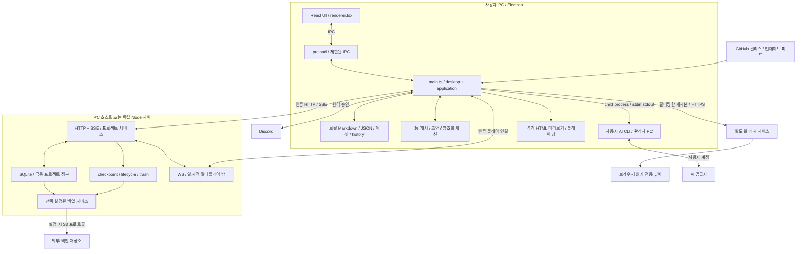
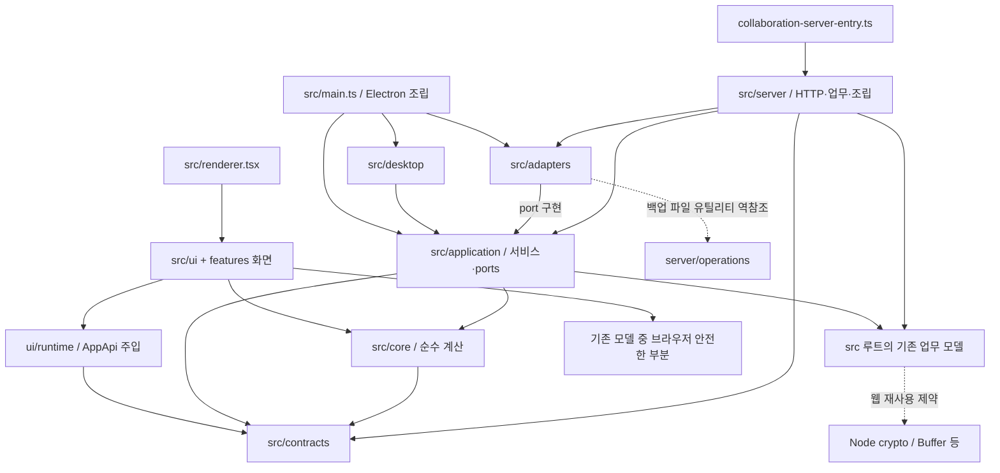
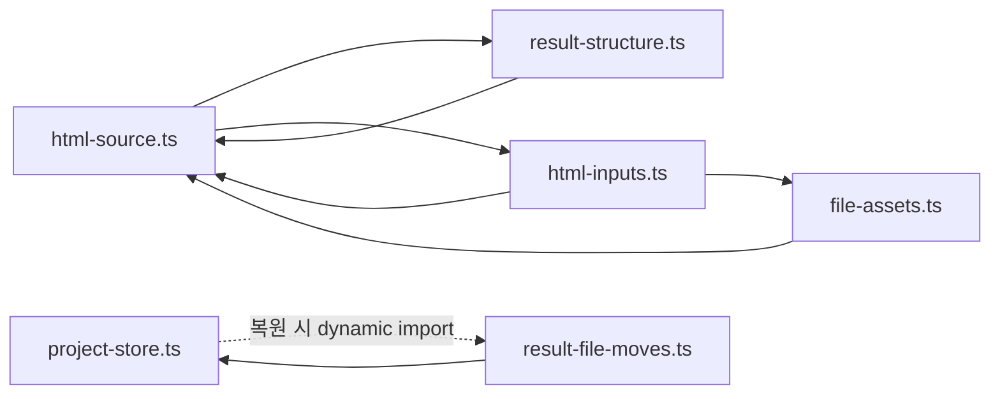
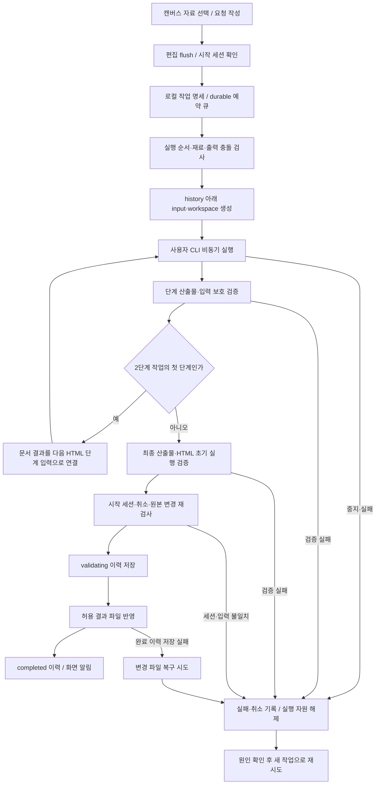
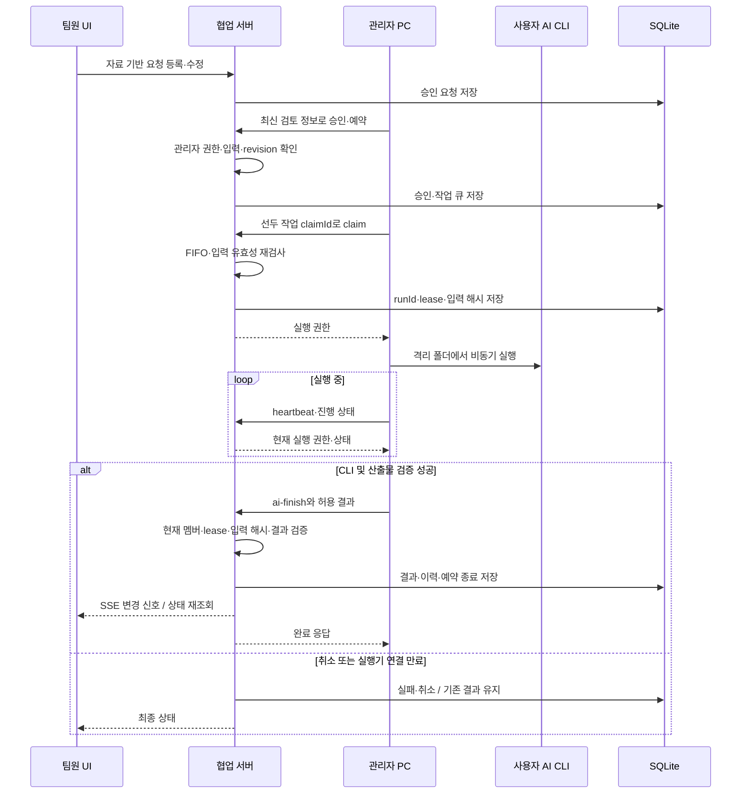
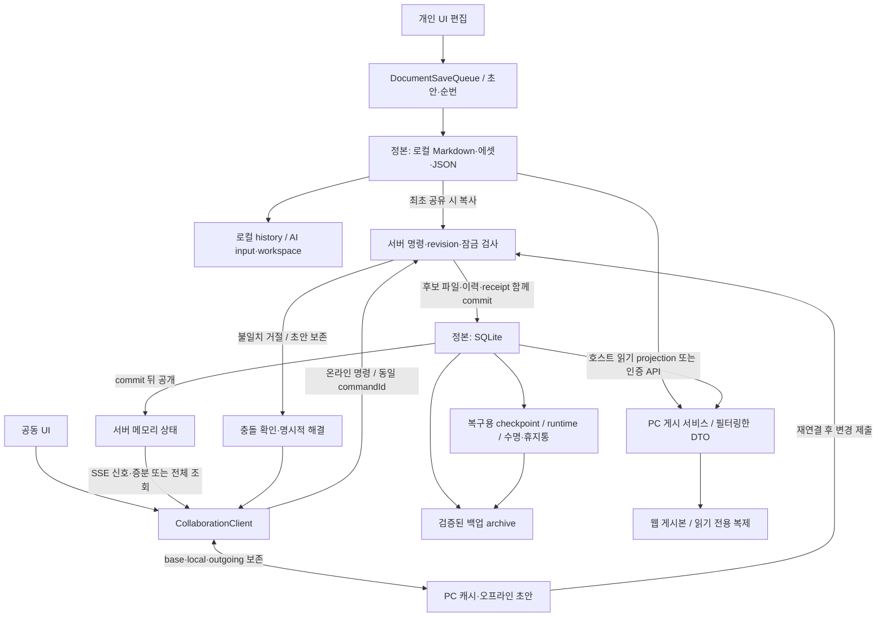
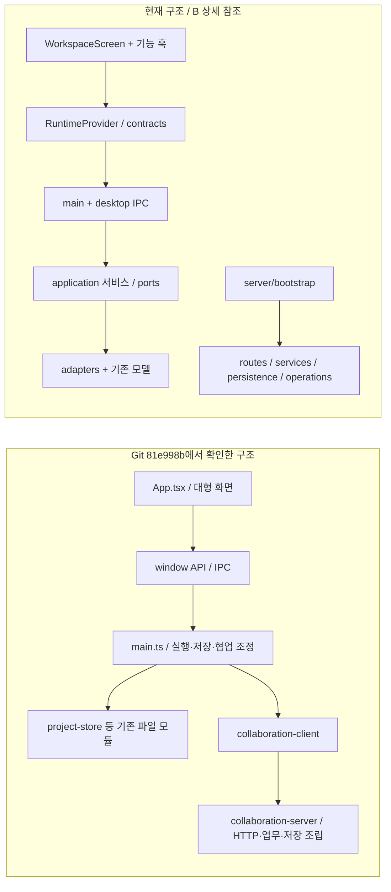

# Game Jam! v0.34.0 아키텍처 및 리팩토링 감사

감사일: 2026-10-22 (KST)

대상: `C:/git/game-jam-dev`, HEAD `61dcbaa`, 현재 작업 사본

성격: 읽기·정적 분석·격리 검증. 애플리케이션 소스 수정 및 배포 없음.

## 1. Executive Summary

**이번 리팩토링은 전체적으로 성공적이다. 현재의 단일 저장소·모듈형 구조를 유지하면서 기능 개발을 계속하는 것이 합리적이다. 다만 “유료 팀 서비스를 즉시 운영할 준비가 끝났다”거나 “공통 로직을 그대로 브라우저로 옮길 수 있다”는 평가는 아직 이르다.**

화면에서 저장·AI 실행을 직접 처리하던 책임을 서비스와 실행 환경으로 나눈 변화는 실제 호출 경로와 테스트에서 확인된다. 서버도 요청 처리, 권한, 작업 순서, DB 저장, 복구용 파일을 구분한다. 파일 이름만 바꾸거나 인터페이스만 추가한 리팩토링은 아니다. 개인 로컬 기능이 서비스 로그인이나 구독에 종속되지 않은 점도 제품 방향에 맞는다.

가장 큰 장점은 다음 세 가지다.

1. **데이터를 확정하는 책임이 명확해졌다.** 서버의 파일·히스토리·요청 처리 기록은 하나의 SQLite 트랜잭션으로 저장된다. 이후 복구용 파일 기록이 실패해도 이미 저장한 명령을 실패로 돌리지 않는다.
2. **AI 실행과 결과 반영을 분리했다.** 관리자 PC의 CLI 실행, 격리 작업 폴더, 결과 검증, 서버 실행 권한을 분리하고 프로젝트 전환 뒤 늦게 도착한 결과를 차단한다.
3. **검증 가능한 경계가 생겼다.** 서비스에 저장소·시계·실행기를 주입할 수 있다. 이번 안전 검사 952개와 타입 검사 3종이 통과했고, 기존 Linux CI의 실제 성공도 GitHub에서 확인했다.

가장 중요한 문제·출시 조건은 다음 다섯 가지다. 현재 결함과 새 제품 기능의 부재를 혼동하지 않는다.

| 우선 항목                             | 구분                           | 결론                                                                                                             |
| ------------------------------------- | ------------------------------ | ---------------------------------------------------------------------------------------------------------------- |
| AI 완료 응답 유실                     | 확인된 결함, P1                | 서버에는 성공했지만 실행 PC는 실패로 판단할 수 있다. 완료 결과의 재조회·동일 요청 재생이 필요하다.               |
| 본문 캐시·DB blob·체크포인트 증가     | 확인된 구조적 위험, P1         | 이력 300개 제한이 전체 메모리·디스크 사용량을 제한하지 않는다. 장기 운영 전에 보존 정책과 제한을 구현해야 한다.  |
| 서비스 계정·팀·구독 권한              | 미구현 제품 기능, 출시 조건 P1 | 계약의 형태는 준비되어 있으나 실제 인증·과금 권한 적용은 없다. `managed` 시작도 의도적으로 차단한다.             |
| 외부 백업 복원과 운영 환경            | 미검증 출시 조건 P1            | Linux CI는 성공했다. 실제 비공개 S3에서 원본 디스크 없이 복원한 증거와 Render 운영 검증은 별도로 남는다.         |
| 웹에서 사용할 업무 로직의 플랫폼 결합 | 확인된 구조적 한계, P2         | `application`의 간접 의존성이 `node:crypto`·`Buffer`에 도달한다. 웹 편집기는 runtime 교체만으로 완성되지 않는다. |

**P0 문제는 이번 범위에서 확인하지 못했다.** 이는 모든 권한 우회·데이터 손실 가능성을 배제했다는 뜻이 아니다. 새로 확인한 AI 완료 응답 문제도 리팩토링 전부터 존재하던 동작이며 신규 회귀로 분류하지 않는다.

이번 결과는 현재 작업 사본 기준이다. 시작부터 `README.md`, `package.json`의 수정과 정리 도구·테스트 등 신규 파일 8개가 있었다. 원래 변경을 보존했다. 배포 소스 `d66604d`의 과거 검증과 현재 검사를 구분하며, 테스트 수 증가를 모두 리팩토링 성과로 계산하지 않는다.

## 2. 현재 프로젝트 아키텍처 개요

### 2.1 실제 실행 단위와 계층

현재 구조는 **Electron 데스크톱 + 단일 Node 협업 서버 + 별도 읽기 전용 웹 게시 서비스**다. 내부적으로 역할을 나눈 모듈형 구조이며 마이크로서비스가 아니다. SQLite 서버를 여러 프로세스에서 동시에 쓰는 구성도 아니다.

`src`의 TypeScript/TSX 482개 파일을 전수 목록화하고 정적 import/export 관계를 조사했다. 아래 줄 수는 빈 줄과 마지막 개행을 포함하는 `split('\n').length` 기준이다. 전체 파일의 모든 함수·분기를 전수 실행한 감사는 아니며, 저장·권한·AI·복구·동기화의 주요 경로를 상세 추적했다.

| 영역                      | 파일 / 줄 수 | 실제 책임과 평가                                                                                                                                                                    |
| ------------------------- | -----------: | ----------------------------------------------------------------------------------------------------------------------------------------------------------------------------------- |
| `contracts`               |   36 / 2,454 | API·명령·DTO·기능 지원 계약. 구현 import를 금지하는 기존 검사와 DOM/Node 전역 없는 strict 타입 검사 존재. 미래 계정/구독 타입도 포함하므로 타입 존재만으로 구현 완료로 보지 않는다. |
| `core`                    |      6 / 253 | 문서 편집 계산, 레이아웃, 섹션 멤버, 출처, AI 카탈로그. 실제로 작고 플랫폼 독립적이다. 프로젝트의 모든 도메인 로직이 이곳에 옮겨진 것은 아니다.                                     |
| `application`             |   38 / 3,111 | 프로젝트 세션, 편집, AI 준비·검증·큐·실행 조정, 저장소 port. 직접적인 Node import는 없지만 legacy 업무 모듈을 통해 간접 의존한다.                                                   |
| `adapters`                |   22 / 2,085 | 파일, SQLite, HTTP 전송, CLI 인자/탐색, 백업 대상 구현. 일부 백업 adapter는 `server/operations`의 파일 유틸리티를 참조한다.                                                         |
| `desktop`                 |   26 / 1,762 | IPC 기능별 등록, 시작 프로젝트에 고정된 경로·세션, CLI 프로세스·작업 폴더, OS 기능. 전체 앱 조립은 아직 `src/main.ts`가 많이 소유한다.                                              |
| `server`                  |   66 / 6,821 | HTTP, 프로젝트 FIFO, 인증·권한, AI 승인/lease, 상태·수명·히스토리, persistence, 운영·백업. `bootstrap.ts` 650줄은 서비스 조립의 중심이다.                                           |
| `ui`                      | 119 / 36,317 | React 화면·훅·runtime·디버그 화면. `App.tsx`는 12줄이지만 실제 화면 조립은 `WorkspaceScreen.tsx` 3,892줄에 집중된다.                                                                |
| `src` 바로 아래 파일      | 123 / 24,427 | 기존 위치의 모델·클라이언트·저장·진입점 및 호환 재수출. 이 보고서에서 편의상 legacy라고 부르며 전부 폐기 대상이라는 뜻은 아니다.                                                    |
| `features`, `multiplayer` |   46 / 9,821 | 그림/게임 UI/칸반/self-host 및 일시적 플레이 세션. 화면·모델·OS 코드가 기능별로 공존한다.                                                                                           |

주요 진입점은 `src/main.ts`, `src/preload.ts`, `src/renderer.tsx`, `src/collaboration-server-entry.ts`다. `src/collaboration-server.ts`는 7줄의 호환 재수출이다. `desktop/bootstrap.ts`는 업데이트·웹 게시·self-host 서비스의 수명 소유자이지 `main.ts` 전체를 대체하는 진입점이 아니다.

### 2.2 실제 의존 방향

- UI는 `RuntimeProvider`의 `AppApi`와 환경 능력을 이용한다. `groupBridge`는 기존 131개 최상위 API 멤버를 그룹으로 묶고 메서드 바인딩·선택적 API·콜백 정체성을 보존한다. 이 래퍼는 점진 이행 목적에 타당하지만 API 수나 업무 책임 자체를 줄이지는 않는다.
- `core`와 `contracts`의 경계는 실제로 작동한다. UI renderer에서 자체 소스의 명시적 런타임 의존 경로를 따라갔을 때 Node/Electron 진입은 발견하지 못했다. 단, 제3자 패키지 내부까지 무의존이라고 증명한 것은 아니다. 브라우저 빌드에서는 `js-yaml`의 `buffer` 외부화 경고가 있었다.
- `application → legacy` 런타임 파일 간 연결은 48개, `server → legacy`는 80개, `ui → legacy`는 129개였다. 중복 제거한 파일 간 연결 수이며 함수 호출 수가 아니다. 예를 들어 편집 서비스는 실제 계산을 `collaboration-model.ts`에 위임한다.
- `application/editing/command-service.ts → collaboration-model.ts → node:crypto`, `application/ai/run-service.ts → html-source.ts → node:crypto`가 확인된다. `collaboration-model.ts:171,181`은 `Buffer.byteLength`도 사용한다. 시계·ID port가 존재해도 브라우저에서 그대로 import 가능한 상태는 아니다.
- 런타임 순환 연결 집합 2개가 확인된다. HTML/에셋 모델 4개 파일과 파일 저장/결과 이동 2개 파일이다. 타입만의 순환과 구분하여 7절에서 평가한다.

### 2.3 구현·계약·향후 작업 구분

| 제품 방향      | 실제 구현                                                                         | 계약 또는 계획                                            | 앞으로 필요한 것                                                           |
| -------------- | --------------------------------------------------------------------------------- | --------------------------------------------------------- | -------------------------------------------------------------------------- |
| 개인 무료 로컬 | 파일 기반 프로젝트, 편집/초안/복구, 사용자 CLI, 히스토리, 미리보기                | 로그인 없이 유지하는 방향이 최신 계획과 일치              | 서비스 계정 도입 때도 로컬 경로의 독립성 유지                              |
| 팀 공동 작업   | 프로젝트 멤버 토큰, admin/editor/viewer, 초대·회수·복구, 동기화, 승인/큐          | `ProjectAccess`, `VerifiedActor`, `WorkspaceEntitlements` | 서비스 사용자, 팀 membership, 프로젝트 소속, 로그인 세션, 구독 판정        |
| 운영 서버      | 독립 번들, writer lock, migration, readiness/drain, 백업/복원/이전 CLI, telemetry | Render 단일 서비스/디스크 설정, 운영 절차                 | 실제 운영 환경 검증, 외부 복원 실증, 운영 책임/알림/목표 확정              |
| 웹             | 읽기 전용 `WebProject` 게시, PC 동기화                                            | 실제 웹 runtime을 도입할 경계                             | 인증·Origin/CSRF·SSE/WS 인증, 웹 저장/캐시 adapter, 편집 화면 연결         |
| iOS            | 별도 iOS 구현 확인 안 됨                                                          | 언어 독립적으로 옮길 수 있는 데이터 개념                  | 제한된 API·인증·알림·화면. TS 타입을 SwiftUI 화면 재사용으로 해석하지 않음 |

최신 방향은 계획서 1절과 45절을 함께 읽어야 한다. 초기 계획의 서버 AI 실행 제안이나 오래된 협업 안내보다 **관리자 PC CLI 실행 유지, 개인 무료, 운영 팀 공간 유료화**가 우선이다. `BUSINESS_MODEL_RESEARCH_2026-10-13.md:7`의 팀 공간 중심 제안도 이 방향과 일치한다. 가격·좌석 계산은 확정 구현이 아니다.

## 3. 전체 시스템 및 주요 흐름 다이어그램

아래 다이어그램은 현재 구현만 표현한다. `Blob/웹 서비스`는 이 저장소의 게시 client와 문서에서 확인한 외부 경계이며 외부 backend 내부를 감사한 것은 아니다. Mermaid 검증 결과는 12절에 기록한다.

### A. 전체 시스템 구조



서버와 실행 PC는 같은 컴퓨터일 수도, 다른 컴퓨터일 수도 있다. 서버가 CLI 인증·실행을 대신하지 않는다. Cloudflare 터널은 PC 호스트의 선택적인 전송 경로이며 도메인/저장 계층이 아니다. AI·Discord·S3의 실제 외부 계정은 이번 검사에서 사용하지 않았다.

근거: `desktop/bootstrap.ts:22`, `desktop/ai/node-executor.ts:39`, `server/bootstrap.ts:96`, `multiplayer/server.ts`, `web-viewer-service.ts:95`, `web-viewer-sync.ts:8`, `app-update.ts:21`.

### B. 코드 아키텍처와 의존 관계



화살표는 코드 의존 방향이다. IPC 통신을 TypeScript import처럼 그리지 않았다. 점선은 확인된 경계 잔여 항목이며 모두 즉시 장애라는 의미는 아니다. UI는 `application`을 직접 실행하는 구조가 아니라 API 경계를 통해 desktop 또는 향후 web runtime에 업무를 요청한다.

확인된 순환은 다음과 같다. 파일 저장 쪽 점선은 복원 함수 안의 지연 `import()`로, 모듈 시작 시 실행되는 정적 순환과는 다르다.



### C-1. 개인 프로젝트 AI 실행



개인 실행에는 서비스 계정·결제·협업 서버가 필요 없다. 2단계 작업은 마지막 검증 전 원본 결과에 반영하지 않는다. 앱 종료 뒤의 중단 이력 복구도 존재하지만 전원 차단 시 모든 파일 작업의 원자성을 실증한 것은 아니다.

근거: `application/ai/run-service.ts:35`, `application/ai/run-coordinator.ts:76`, `application/ai/queue-service.ts:26`, `desktop/ai/stage-workspace.ts:12`, `project-store.ts:249`.

### C-2. 공동 프로젝트 AI 실행



편집·예약·승인 중복 방지와 AI 완료 중복 방지는 동일하지 않다. claim은 같은 `claimId`로 재시도 가능하지만, **마지막 완료 응답을 잃으면 현재 `finishAi`에는 완료 receipt 재생이 없다**(F01). 재시작 시 실행 중 job은 만료 대상으로 처리하고 queued 예약은 보존한다. 실패한 AI를 무조건 자동 재실행하지 않는다.

근거: `server/services/ai-coordinator.ts:64`, `ai-run-service.ts:24,107`, `ai-result.ts:21`, `member-service.ts:58`, `server/bootstrap.ts:205`, `collaboration-client.ts:1492`.

### D. 데이터 저장 및 동기화



공유 후 공동 편집은 서버 정본에 반영되며 **원래 개인 폴더에 자동 역동기화하지 않는다**. 공동 캐시는 정본을 대체하지 않는다. 오프라인 변경은 기준본과 변경본을 보존하고, 서버가 현재 권한·revision·AI 보호 규칙을 다시 검사한다. 같은 문서의 문자 단위 CRDT는 없다. 속성별 버전으로 본문과 배치 등의 불필요한 충돌을 줄이고 본문 충돌은 보존·해결 대상으로 남긴다.

SQLite 체크포인트와 프로젝트 파일 체크포인트도 구분해야 한다. 후자는 복구용 `head.json/checkpoints/...`이며 실행 중 수동 편집 대상이 아니다. 웹 게시본에는 편집 명령·권한 토큰·전체 히스토리를 보내지 않고, 게시 PC가 꺼지면 최신화가 중단될 수 있다.

근거: `document-save-queue.ts:56`, `client-cache.ts`, `collaboration-client.ts:1116`, `server/services/offline-sync-service.ts:34`, `server/persistence/project-persistence.ts:48`, `web-viewer.ts:15`, `web-viewer-source.ts:20`.

## 4. 리팩토링 품질 및 기능 안정성 검증

### 4.1 구조 개선의 실질성

**세션 소유권, 업무 순서, 저장의 성공 경계가 개선되었다.** `ProjectSession`은 자원 해제와 취소를 소유하고, desktop 서비스는 시작한 root/session을 캡처한다. UI의 화면 방문 수명과 backend 저장의 성공 여부도 구분한다. A→B→A 프로젝트 전환에서 과거 응답이 새 화면을 덮어쓰는 문제를 다루는 검사가 존재한다.

`SharedEditingService.execute`는 세션·허용 명령 확인, 인증 client 명령, 로컬 mirror/trash 연결, Undo receipt 기록을 소유한다. `DocumentEditingService.save`는 현재 문서·기준본·객체 ID 검증 뒤 repository에 교체를 요청한다. `AiRunCoordinator`는 실행 상태·취소·단계·최종 기록을 소유하며 `NodeAiExecutor`는 프로세스만 소유한다. 서버 서비스는 HTTP 객체나 SQLite 연결 대신 필요한 port를 받는다. 이 경계는 독립 테스트에 실제 사용된다.

반면 완성된 엄격 계층 구조는 아니다. `main.ts`에 IPC 분기와 native 차이가 남고, `WorkspaceScreen`이 많은 상태를 조립한다. 기존 reducer와 native 개인 명령은 일부 경로가 다르다. `tests/shared-editing.test.mjs`의 공통 명령 검사가 모든 native 파일 처리·휴지통 동작까지 증명하지는 않는다. 구조를 더 정리할 때는 실제 변경 기능의 경로를 기준으로 범위를 좁혀야 한다.

호환 재수출(`shared.ts`, `sync-store.ts`, `collaboration-server.ts`)과 `groupBridge`는 기존 API·데이터 형식을 보존하기 위한 제한된 추상화로 이해할 수 있다. 지금 제거하려고 광범위한 import 교체를 수행할 이득은 작다. 새 도메인 로직을 무조건 루트 파일에 추가하는 관행은 막아야 한다.

### 4.2 이번 직접 검증

| 검사                             | 결과                  | 해석과 한계                                                                                                |
| -------------------------------- | --------------------- | ---------------------------------------------------------------------------------------------------------- |
| 루트 `tsc --noEmit`              | 통과                  | 전체 strict가 아니다. `noImplicitAny`와 현재 설정 기준이다.                                                |
| contracts/core 별도 `tsc -p`     | 두 검사 통과          | strict, `types: []`, ESNext 라이브러리. 전체 application이 브라우저 독립임을 보장하지 않는다.              |
| `oxlint`                         | exit 0, 경고 1        | `tests/mocks/discord-transport.ts:12`의 `no-this-alias`.                                                   |
| `oxfmt --check`                  | exit 1                | `UPDATES.md` 1개 파일 형식 문제. 소스는 수정하지 않았다. 현재 `npm run lint` 전체 성공으로 보고할 수 없다. |
| 안전한 기존 `*.test.mjs` 120파일 | 952 통과, 실패/skip 0 | 전체 123파일에서 저장소 출력에 쓰는 3파일 제외. 추가 미커밋 정리 도구 테스트 포함.                         |
| renderer Vite 메모리 빌드        | 통과, 출력 5개        | `write:false`. 설치 앱 빌드가 아니다. 경고는 아래 설명.                                                    |
| 독립 서버 Vite 메모리 빌드       | 통과, 출력 1개        | `write:false`, Node24/SSR/noExternal. 실제 번들 파일 실행·Forge 패키징은 이번에 수행하지 않았다.           |
| 메모리 기반 추가 재현 3건        | 예상 문제 확인        | AI 완료 응답 유실, 본문 캐시 증가, 개인 저장/이력 부분 성공. F01~F03 참조.                                 |

메모리 빌드 경고는 `new URL('../index.html', import.meta.url)`의 실행 시 해석, `js-yaml`의 browser `buffer` 외부화, `gray-matter` 내부 `eval`이다. `src/markdown.ts:4`는 frontmatter 첫 줄을 YAML/YML로 제한한다. 따라서 번들에 `eval` 코드가 있다는 사실만으로 문서 입력 원격 코드 실행 취약점을 확정하지 않았다. 실제 설치 패키지 경로·임의 문서 보안 전수 검증은 별도다.

### 4.3 핵심 기능별 증거와 남은 검증

| 기능                 | 확인한 구현·이번 검사                                                                                                                                  | 미검증 또는 과거 증거                                                                 |
| -------------------- | ------------------------------------------------------------------------------------------------------------------------------------------------------ | ------------------------------------------------------------------------------------- |
| 개인 저장·복구       | `document-service`, `document-save-queue`, `project-files`, `gamejam-history`, `project-trash` 관련 자동 검사. 기준본 확인·원자 교체·중단 AI 이력 복구 | 실제 사용자 자료·물리 디스크 장애·전원 차단 미검증                                    |
| 캔버스·문서 편집     | `workspace-commands`, `markdown-editing`, `document-links`, 그림/game-ui/칸반 모델·서비스 검사                                                         | 이번 실제 드래그·IME·포커스·clipboard UI 재실행 없음                                  |
| AI 실행·작업 큐      | executor/queue/run-service/coordinator, server-ai-start/run, 승인 관련 검사                                                                            | 실제 공급자 로그인·유료 실행 미검증. 완료 응답 유실은 추가 재현에서 문제 확인         |
| HTML 생성·미리보기   | 산출물·문서 bundle·HTML 입력/참조/권한 모델 검사                                                                                                       | 실제 Chromium 게임 초기 실행/의미적 플레이는 이번에 재실행하지 않음                   |
| 시제품 버전·이력     | 결과 경로·파일 이동·history query/restore/undo 검증                                                                                                    | 모든 오래된 사용자 프로젝트 조합 미검증                                               |
| 협업·권한            | 실제 임시 서버 기반 역할/회수/큐/잠금/HTTP/SSE/AI·프로젝트 검사                                                                                        | 실제 외부망 다중 PC·운영 ingress 미검증                                               |
| 오프라인·충돌        | `workspace-offline`, `server-offline-sync`, property sync, cache/session 검사                                                                          | 장시간 오프라인·다수 클라이언트 동시 복구의 서비스 부하 미검증                        |
| 멀티플레이           | `multiplayer.test.mjs`, 계약·권한·재접속·진단 검사                                                                                                     | 이번 별도 Electron 플레이 창 검증 없음. 게임 규칙의 재미/공정성은 자동 검사 대상 아님 |
| 웹 뷰어 게시         | `web-viewer`, `web-viewer-source`, `web-viewer-sync` 검사와 게시 경로 추적                                                                             | 실제 외부 게시·별도 웹 backend·접근 코드 회수 동작 미검증                             |
| 자동 업데이트·호환성 | `app-update`, schema migration, 구형 DB/프로토콜 capability 검사                                                                                       | 이번 실제 설치→다운로드→재시작 없음. 기존 피드 검증은 배포 기록으로만 인용            |

### 4.4 과거 검증과 이번 확인의 구분

`REFACTORING_PLAN_2026-10-20.md:2028`의 45절과 `UPDATES.md:3`에는 v0.34.0 배포 전 943개 자동 검사·Windows 패키지 25종 검증이 기록되어 있다. 실제 공급자 대신 모의 CLI/Discord, 외부 S3 대신 로컬 TLS fixture를 사용한 범위도 명시되어 있다.

[GitHub 실행 39730917943](https://github.com/sehyeok3406/game-jam-dev/actions/runs/39730917943)의 최신 job/step 상태를 읽기 전용 API로 확인했다. `types`, `lint`, `windows-tests`, `linux-server` 네 job 모두 success다. Linux의 `test:server`, build, `collaboration:verify -- --windows-fixture out/ci/windows-backup --load` 단계 성공도 확인했다. **Linux가 계속 미검증이라는 앞부분의 문서 상태는 최신 결과와 다르다.** 다만 이번 API 확인은 전체 로그·artifact 해시 재검증이나 Render 실제 배포 확인이 아니다. 943/211이라는 과거 검사 수와 25개 패키지 세부 결과는 저장소의 검증 기록에 근거한다.

## 5. 실제 서비스 운영 준비도 평가

### 5.1 계정·인증·권한

현재 신원 단위는 프로젝트별 `Member{id,nickname,role,tokenHash,removed}`다(`server/project-state.ts:13`). 이는 서비스 계정과 다르다. `createAccessPolicy.authenticate`는 대상 프로젝트의 현재 멤버 토큰을 검사하고, `createProjectRequest`는 FIFO 안에서 프로젝트와 멤버를 다시 조회한다. 요청 body의 role/actor를 신뢰하는 구조가 아니다. 관리자·뷰어·AI 보호·본문 revision·잠금은 서버에서 다시 확인한다.

SSE도 토큰 인증 뒤 연결하며 멤버 상태를 재검사한다. 멀티플레이 권한도 프로젝트 참여 상태와 연결된다. 실행 중인 AI 관리자의 역할을 바꾸려면 먼저 작업을 중지하게 한다(`member-service.ts:58`). 공개 서버 생성 키, trusted proxy 설정, body 제한과 rate limit도 있다. 이 근거는 긍정적이지만 전체 보안 침투 테스트를 수행했다는 뜻은 아니다.

서비스 사용자 ID·팀 ID·프로젝트 접근 ID를 별개로 정의할 계약은 마련됐다. 하지만 서버 `Project`에 실제 workspace 소유 관계가 없고 `AccessPolicyInput`에 대한 운영 인증/구독 판단 구현도 없다. `server/config.ts:8`은 `managed`를 거부한다. 이 차단을 없애는 것을 계정 기능 구현으로 취급하면 안 된다.

추가할 최소 개념은 서비스 `User`, 로그인 세션, `Workspace`, `Membership`, 프로젝트의 workspace 소속과 사용자 접근, 서버가 계산하는 entitlement다. 기존 memberId를 userId로 재해석하지 말고 명시적 연결·기존 초대/복구 전환 정책을 둔다. 초기에는 동일 서버·SQLite 안에서 구현해도 된다.

### 5.2 구독·무료/유료 경계

`ClientCapabilities`는 PC가 할 수 있는 일이고, `ProjectAccess`는 사용자가 허용받은 일이며, `WorkspaceEntitlements`는 팀 상품의 권리다. 이를 분리한 계약은 적절하다. 개인 저장·CLI 경로에는 구독 확인이 없으므로 무료 로컬 기능을 유지할 수 있다.

결제 integration, webhook 중복 처리, 구독 상태 저장, 유예/만료/해지 정책, 실제 쓰기 차단은 미구현이다. 향후 결제 이벤트를 검증하고 내부 구독 상태를 갱신한 뒤 **서버가 각 변경 요청과 AI 승인/claim/결과 반영 시 팀 권리를 확인**해야 한다. UI의 paid 값이나 생성 키로 대체할 수 없다. 읽기·내보내기와 유료 변경 권한은 별도로 결정한다. 가격·결제 업체 선택은 이번 구조 감사의 결론이 아니다.

### 5.3 SQLite·단일 서버·성능

현재 최대 20프로젝트·프로젝트당 20멤버·500파일·20MB snapshot이라는 보호 한도 아래 **단일 Node 인스턴스와 SQLite는 합리적인 시작점**이다. 이 수치는 검증된 동시 수용 인원이나 상품 quota가 아니다(`contracts/server-limits.ts:2`).

프로젝트별 FIFO는 같은 프로젝트 변경을 직렬화하고 다른 프로젝트의 비동기 작업은 독립 진행하게 한다. 하지만 `DatabaseSync` 트랜잭션과 전체 JSON 직렬화는 동일 Node event loop에서 수행되므로 DB 저장 자체가 프로젝트별 병렬 실행되는 것은 아니다. 시작 시 전체 프로젝트·이력을 메모리로 읽으며 본문 캐시가 늘고, 프로젝트 JSON에 history/receipt를 포함해 다시 저장한다.

단기 우선순위는 bounded cache, 참조 없는 blob 정리, 파일 체크포인트 보존, 저장 p95·RSS·디스크 증가 추세 측정이다. 그 후 필요할 때 이력의 별도 조회·lazy loading을 도입한다. PostgreSQL·Redis·별도 큐 서버를 지금 선행할 근거는 부족하다. 수평 확장 시에는 프로세스 내부 프로젝트 map/FIFO/잠금/SSE/멀티플레이 상태가 공유되지 않는 문제까지 해결해야 하므로 DB 교체만으로 끝나지 않는다.

### 5.4 데이터·백업·복원·마이그레이션

SQLite의 FULL WAL 트랜잭션, blob 해시 검증, schema 0→1 원자 migration, 새 스키마 거부, 삭제 tombstone은 좋은 기반이다. repository의 비동기 인터페이스가 저장 완료의 의미를 명시한다. DB commit 뒤 복구 파일 오류를 구분하고 재시도하는 정책도 확인된다. 개인 파일 저장에는 서버 DB와 동일한 다중 파일 트랜잭션 보장이 없으며 F03의 부분 성공이 남는다.

백업은 DB만 복사하지 않고 `sqlite.backup`으로 일관된 사본과 checkpoint/runtime/lifecycle/trash를 수집한다. 쓰기 gate·writer lock·archive manifest·크기/SHA·안전한 staging·새 폴더 identity 재등록·tombstone·고아 AI 처리를 갖춘다. Windows→Linux 합성 복원 CI도 성공했다. 외부 저장소를 실제 재난 복구 수단으로 검증한 것은 아니다.

S3 설정이 없으면 예약 백업은 꺼진다(`backup-config.ts:26`). 원본 서버/디스크 없이 새 환경에서 실제 비공개 object를 받아 복원하고, 권한·이력·삭제·예약·같은 요청 재전송·재시작을 확인하는 운영 훈련이 필요하다. 복구 목표 시간과 허용 데이터 유실 시간은 팀의 요구·백업 간격·측정 결과로 정해야 한다. 코드 존재를 목표 달성 보장으로 바꾸면 안 된다.

### 5.5 운영·비밀정보·AI 실행

`/health`, `/ready`, 신규 요청 차단, accepted write drain, SSE/WS 종료, checkpoint flush, 종료 제한, writer lock 해제가 구현되어 있다. `operations-status.json`은 RSS·저장 p95·event-loop·디스크·백업 상태를 제공하고 요청 로그는 HMAC 프로젝트 참조를 쓴다. 운영자가 이를 수집·경보·조치하는 실제 체계는 아직 확인하지 않았다. 파일 하나에 지표를 남기는 것과 장애 알림이 도착하는 것은 다르다.

세션·게시 키·Discord 설정에는 OS 암호화 경계가 있다. `NodeAiExecutor`는 `shell:false`, `windowsHide:true`와 provider별 인자를 사용한다. 생성 HTML과 멀티플레이 창에는 별도 preload/권한 경계를 둔다. 반면 프로젝트 문서와 백업 archive 자체는 이 코드가 자동 암호화하는 저장소가 아니다. 운영 디스크·비공개 bucket·접근 권한·보관 정책을 배포 시 적용해야 한다. 실제 외부 서비스 설정과 TLS·네트워크 격리는 이번에 검증하지 않았다.

관리자 PC AI 실행 구조는 제품 방향과 맞는다. 서버가 승인·예약·lease·결과를 소유하고 PC가 자격증명·프로세스·검증 작업을 소유한다. 30초 lease와 heartbeat, 입력 해시, 같은 claimId 재시도, 실행기 단절 실패, queued 유지가 존재한다. 단계 폴더는 원본 보존 장치이지 그 자체로 OS 보안 sandbox는 아니다. 실제 CLI 버전의 격리·로그인·취소 동작은 모의 실행만으로 입증되지 않는다. F01의 완료 응답 불확실성을 먼저 해결해야 한다.

## 6. 웹·모바일 확장 적합성 평가

### 6.1 재사용 가능한 부분과 교체할 부분

| 영역                                            | 재사용 판단                                 | 필요한 연결                                                            |
| ----------------------------------------------- | ------------------------------------------- | ---------------------------------------------------------------------- |
| `contracts`, 순수 `core`                        | TS 웹 client에서 직접 공유 가능             | wire 검증·호환 fixture 유지. iOS에는 DTO 의미/버전·JSON 계약을 옮김    |
| 서버 권한·승인·큐·결과 검증                     | 기존 Node 서버에서 계속 재사용              | 웹 인증을 현재 actor 경계에 연결. CLI는 관리자 PC에 유지               |
| React 화면·문서/캔버스 훅                       | 다수 재사용 가능                            | 실제 web runtime, 기능 지원 값, 브라우저 저장/다운로드/clipboard 차이  |
| DocumentSaveQueue·property 계산·session 수명    | port 중심 로직은 재사용 유리                | IndexedDB 등 웹 영속 초안·오프라인 adapter 및 복구 UX                  |
| `application` 전체, 기존 reducer                | 그대로 browser import는 불가                | Node/Buffer 의존 정리 또는 서버 실행으로 유지. 실제 필요한 계산만 추출 |
| 파일 저장·OS 세션 암호화·CLI·업데이트·self-host | 데스크톱 전용                               | HTTP/웹 저장소·브라우저 인증으로 교체하거나 해당 기능을 제공하지 않음  |
| 현재 웹 게시 DTO                                | 읽기 전용 projection으로 유지               | 편집 원본·편집 revision/권한 계약으로 그대로 사용하지 않음             |
| iOS 화면                                        | React/Electron 화면 직접 재사용 전제 부적절 | 문서 열람·댓글·요청/승인·알림의 작은 클라이언트부터 별도 구현          |

`renderer.tsx:28`은 production에서 Electron API가 없으면 실패한다. preview runtime은 fixture이며 실제 웹 editor가 아니다. `server/http/router.ts:28`은 Origin 요청을 거부한다. 웹 지원 시 단순히 이 조건을 제거하지 말고 인증·허용 출처·CSRF·SSE/WS 자격 증명·로그아웃/회수·재연결을 함께 설계해야 한다.

동시 편집 규칙은 초기 팀 규모에 실용적이다. 문자 단위 실시간 공동 편집이 필요하지 않다면 잠금+속성 revision+초안 보존을 유지한다. 웹과 desktop이 동일 서버 명령·검증을 사용하고 오프라인 명령의 중복 제거·객체 세대·명시적 충돌 해결을 공유하는 것이 먼저다. CRDT는 실제 요구가 확인될 때 별도 결정한다.

### 6.2 지금 준비할 것과 미룰 것

지금은 서비스 identity를 project member와 분리하고, wire 오류·기능 지원 버전·완료 결과 조회 계약을 고정하며, 새 공통 계산에 Node/DOM 의존을 넣지 않는 검사를 추가하는 것이 효과적이다. 웹에서 첫 번째로 편집할 기능 하나를 선택한 뒤 그 경로의 ID/hash/byte 계산과 저장 port를 정리한다.

웹 전체 runtime·오프라인 저장소·브라우저 보안 integration은 웹 편집 구현 단계에 수행한다. iOS 전체 API 생성 도구, 모든 화면 추상화, 전체 shared 코드를 별도 패키지로 분리하는 작업, 다중 서버 분산 잠금은 지금 선행하지 않는다. 댓글·알림은 현재 승인 요청/히스토리 기능과 동일하다고 가정하지 말고 실제 제품 기능으로 정의한다.

## 7. 발견된 문제점 및 근거

F는 현재 코드에서 확인한 문제, L은 아직 구현·실증되지 않은 출시 조건이다. P1은 즉시 모든 개인 사용을 중단해야 한다는 뜻이 아니라 해당 서비스 출시 전에 해결할 중요도를 뜻한다.

### F01. AI 완료 응답 유실 시 서버 성공과 실행 PC 실패가 갈라짐

- **심각도:** P1. 합성 입력을 이용해 재현한 현재 결함.
- **위치:** `src/collaboration-client.ts:1492–1510`, `src/server/services/ai-run-service.ts:116,173–209`, `src/application/ai/run-coordinator.ts:309–331`, `src/main.ts:920`.
- **근거:** client는 `ai-finish`가 실패해도 finally에서 lease를 지운다. 서버는 성공 commit 때 job을 null로 바꾸며, job이 없으면 완료 재전송을 거부한다. coordinator는 publish 예외를 failed로 바꾼다. 일반 편집의 durable receipt와 달리 AI 완료 확인 경계가 없다.
- **재현:** 기존 `server-ai-run.test.mjs`의 fixture와 실제 `CollaborationClient.prototype.finishAi`를 연결하고 서버 service가 성공한 직후 응답 유실 예외를 주입했다. `serverLastRun=completed`, 결과 존재, `serverJob=null`, `clientLease=null`, `clientAccepted=false`였으며 재전송은 “AI 작업이 끝났거나 실행 권한이 만료되었습니다”로 거부됐다. 실제 외부망/전체 UI가 아닌 메모리 service/client 경계 재현이다.
- **상황·영향:** 결과 저장 직후 연결 단절·타임아웃이 발생하면 사용자가 성공한 작업을 실패로 오해한다. 반대로 요청이 서버에 도착하기 전 일시 실패해도 lease를 잃어 검증한 결과를 정상 재제출할 경로가 없다. 무조건 새 AI 실행을 권하면 불필요한 실행·지원 비용이 생긴다. 서버의 저장 결과가 삭제됐다는 재현은 아니다.
- **권장:** runId/완료 operationId와 결과 fingerprint에 대한 durable completion receipt, 권한 검증된 완료 상태 조회, 같은 결과의 멱등 재전송을 추가한다. 상태 불명은 failed와 구분하고 확인 전 lease/결과 재시도 정보를 보존한다. 다른 run·다른 actor·다른 결과의 재사용은 거부한다.
- **규모:** 중간. **선행/관련:** AI 계약·서버 저장·client 재접속·coordinator 상태. commit 전 실패/commit 후 응답 유실/서버 재시작을 함께 검사.
- **전후 구분:** `81e998b`의 `finishAi`에도 같은 finally 동작이 있다. 리팩토링으로 새로 생긴 결함이라고 주장하지 않는다.

### F02. 히스토리 제한과 별개로 본문 캐시·DB blob·파일 체크포인트가 증가

- **심각도:** P1, 장기 운영 전 해결할 자원 위험. 캐시 증가를 재현했고 실제 OOM/디스크 고갈은 재현하지 않았다.
- **위치:** `src/adapters/sqlite/project-repository.ts:14,25,40,81,115,168`, `src/server/services/project-history-writer.ts:95`, `src/server/persistence/checkpoint-store.ts:43`, `src/server/lifetime.ts:25`.
- **근거:** `hashes`는 본문 전체 문자열을 key로 계속 저장한다. 일반 저장에는 eviction이 없고 blob GC는 project purge 경로에 있다. history를 300개로 줄여도 사용하지 않는 blob이 일반 저장에서 제거되지 않는다. checkpoint write는 UUID 디렉터리를 새로 만들며 이전 세대 정리 경로가 없다.
- **재현:** `SqliteProjectStore(':memory:')`에 같은 파일을 다른 10KB 본문으로 100회 저장하고 history를 항상 빈 배열로 두었다. 현재 파일은 1개인데 `cachedBodies=100`, `cachedBodyBytes=1000190`이었다.
- **상황·영향:** 장시간 편집·AI 산출물 교체가 지속되면 현재 프로젝트 크기가 작아도 RSS/DB/백업/디스크 사용이 증가한다. 서버 시작은 전체 이력 로드 비용도 부담한다. 기술 quota만으로 운영 용량을 보장할 수 없다.
- **권장:** 캐시에 최대 항목/바이트 한도를 두고, GC는 현재 파일·보존 이력 참조를 계산해 안전한 트랜잭션으로 실행한다. checkpoint는 현재 head·백업 캡처·진행 작업을 보호하는 세대 보존 정책을 둔다. DB 실제 파일 축소는 GC와 별개로 운영 계획에 포함한다.
- **규모:** 중간. **선행/관련:** 보관 정책·백업과 삭제의 동시성·저장소 회귀. lazy loading/이력 분리는 측정 후 별도.
- **전후 구분:** 기존 저장 모델을 유지한 잔여 위험이며 계획서 R08 측정에도 명시된 항목이다.

### F03. 개인 파일 반영 성공 뒤 이력 실패가 전체 명령 실패로 전달됨

- **심각도:** P2. 부분 성공의 표현·복구 문제.
- **위치:** `src/application/editing/local-mutation-service.ts:68,97,101`, `src/application/editing/user-edit-recorder.ts:29,73`, `src/main.ts:1688`.
- **근거:** 원본 operation이 파일을 바꾼 다음 이력을 기록한다. 이력 저장이 실패하면 예외가 올라가고 `changed()`에 도달하지 않는다. 서버의 commit 이후 오류 분리와 같은 보장은 없다.
- **재현:** 실제 LocalMutationService에 합성 capture/write와 실패하는 record port를 주입했다. 파일 값은 `after`로 바뀌었지만 명령은 이력 오류로 reject되고 변경 알림은 호출되지 않았다.
- **상황·영향:** `.history` 쓰기 실패 등에서 사용자는 저장 실패를 보지만 파일은 변경되어 있을 수 있다. Undo 이력과 재시도 판단이 불명확하다. 물리 데이터 손실을 확정한 것은 아니다.
- **권장:** 저장 완료와 이력 실패를 분리한 결과·사용자 안내·이력 재시도/복구 기록을 설계한다. 무조건 파일 rollback을 추가하면 외부 변경을 덮을 수 있으므로 기존 기준본 검사를 유지한다.
- **규모:** 중간. **선행/관련:** 문서 저장 queue의 성공 정의, Undo 정책, 재시작 복구. R04 완료 기록에도 보존된 한계로 기술되어 있다.

### F04. application의 간접 Node 의존성과 경계 검사의 적용 범위가 좁음

- **심각도:** P2. 웹 재사용을 위한 준비 부족이며 현재 desktop 오류는 아니다.
- **위치:** `src/application/editing/command-service.ts:3`, `src/collaboration-model.ts:48,171,390`, `src/application/ai/run-service.ts:17`, `src/html-source.ts:1,29`, `src/file-assets.ts:2,39`, `tests/runtime-contracts.test.mjs:16`.
- **근거:** 위 경로가 Node crypto와 Buffer에 도달한다. 전수 정적 조사에서 application에 직접 Node import가 없다는 결과와 양립한다. strict core 검사 대상은 6개 파일이며 기존 모델 전체를 검사하는 browser boundary는 아니다.
- **상황·영향:** 웹 runtime을 연결하면서 업무 service를 그대로 import하면 플랫폼 모듈 오류 또는 polyfill 부담이 발생한다. 동일 규칙을 복제하면 desktop/server/web 간 규칙 차이가 생긴다.
- **권장:** 우선 필요한 웹 업무 경로의 ID·해시·바이트 계산을 port/순수 구현으로 분리하고 transitive import 검사와 웹 build fixture를 둔다. 서버에서 실행할 검증까지 브라우저로 모두 옮길 필요는 없다. legacy 예외는 명시적으로 관리한다.
- **규모:** 중간. **선행/관련:** 첫 웹 편집 범위 선택. 지금 전체 소스 이동이나 별도 패키지화는 불필요.

### F05. HTML 모델·파일 저장 경계에 실제 런타임 순환 참조가 남음

- **심각도:** P2. 현재 초기화 장애는 발견하지 못한 유지보수 위험.
- **위치:** `src/html-source.ts:11,15`, `src/html-inputs.ts:4,6`, `src/file-assets.ts:5`, `src/result-structure.ts:9`, `src/result-file-moves.ts:3`, `src/project-store.ts:509`.
- **근거:** 타입 제거 후 그래프에 `{html-inputs,result-structure,html-source,file-assets}`와 `{result-file-moves,project-store}`라는 두 강결합 집합이 존재한다. 첫 집합에서는 경로/ID·분석·에셋 처리 책임이 되물린다. 두 번째는 저장소의 복원 함수에서 이동 모듈을 지연 import하는 구조로, eager 초기화 순환은 아니다.
- **상황·영향:** HTML 모델의 최상위 초기화나 브라우저 분리 변경 시 연결된 파일을 함께 이해해야 한다. 파일 저장/이동의 경우 지연 로드로 초기화 위험은 줄였지만 책임 간 결합은 남는다. 순환 자체를 현재 장애로 취급하지 않는다.
- **권장:** HTML ID/경로/해시 같은 하위 규칙과 파일 경로 검증을 의존 없는 작은 모듈로 추출한다. 이동 orchestration은 상위 계층이 두 서비스를 조합하게 한다. 관련 기능 변경 시 묶어서 정리한다.
- **규모:** 작음~중간. **선행/관련:** F04와 관련 있으나 전면 계층 이동은 필요 없음.

### F06. main과 WorkspaceScreen의 변경 영향 범위가 여전히 큼

- **심각도:** P2. 크기만이 아니라 책임 집중을 근거로 평가.
- **위치:** `src/main.ts:1492–1784,1976`, `src/ui/workspace/WorkspaceScreen.tsx:171` 이하. 현재 각각 2,977줄/3,892줄.
- **근거:** main의 공통 handle은 sender·session·공동/개인 dispatch·AI 시작·mutation·property flush·오류·clipboard 재전송을 함께 다룬다. WorkspaceScreen은 runtime, 자료 선택, 패널, AI/문서/그림/칸반 등의 상태·콜백을 조립한다. App 12줄만으로 화면 책임 분리가 완료됐다고 볼 수 없다.
- **상황·영향:** 신규 기능이 공통 dispatch나 화면 수명에 들어오면 여러 기능 회귀를 확인해야 한다. 루트 파일과 dev fixture의 별도 동작도 변경 비용을 늘린다.
- **권장:** 다음 기능 개발 때 해당 상태·명령의 소유자만 추출한다. 공통 pipeline 순서와 세션 검사 의미를 고정하고 `main`에는 조립을 남긴다. 무분별한 전역 Context 또는 서비스 컨테이너 추가는 피한다.
- **규모:** 중간, 단계별. **선행/관련:** 기존 session/IPC/UI 회귀 유지. 출시 전체를 막는 전면 재작성 사유는 아님.

### F07. 최신 완료 상태와 문서 첫 안내·현재 형식 검사가 불일치

- **심각도:** P3. 운영 판단 혼동과 개발 검사 실패.
- **위치:** `REFACTORING_PLAN_2026-10-20.md:5,2028`, `docs/operations/backup-restore.md:3` 및 검증 상태, `COLLABORATION.md:124,138,140,144`, `UPDATES.md:13` 부근.
- **근거:** 계획서 첫 상태와 복원 문서는 Linux 실증 대기라고 하지만 45절과 GitHub job은 성공이다. 구형 협업 안내에는 체크포인트 중심 저장 설명, 서버 AI 실행 확장, 편집자 AI 실행 문구가 남아 현재 DB 정본·관리자 실행 정책과 혼재한다. 이번 oxfmt는 UPDATES 한 파일에서 실패했다. 이전 d66604d CI lint 성공과 현재 HEAD 문서 형식 실패를 구분해야 한다.
- **상황·영향:** 새 운영자가 이미 끝난 Linux 확인을 반복하거나 현행 권한/정본을 잘못 이해할 수 있다. 현재 CI의 형식 단계도 막힐 수 있다.
- **권장:** 문서 상단에 최신 상태와 날짜·정본 문서 링크를 두고 과거 기록은 역사로 명시한다. UPDATES 형식만 별도 정리한다. 이번 감사에서는 수정하지 않는다.
- **규모:** 작음. **선행/관련:** 없음. 외부 S3·Render 미완료 표시는 계속 유지.

### L01. 서비스 계정·팀 소속·구독 enforcement가 아직 없음

- **심각도:** 유료 서비스 출시 조건 P1. 현재 self-host 권한 우회 결함으로 분류하지 않음.
- **위치:** `src/contracts/access.ts:4–34`, `src/contracts/capabilities.ts:14`, `src/server/project-state.ts:13,44`, `src/server/config.ts:8`.
- **근거:** 서비스 identity/entitlement는 타입으로 준비됐으나 실제 서버 인증·저장·정책 적용이 없다. managed 모드 시작을 차단한다.
- **상황·영향:** 현 상태의 managed-beta를 정식 팀 구독 서비스로 제공하면 계정별 접근·팀 소속·해지/만료 정책을 보장할 수 없다.
- **권장:** 사용자/팀/프로젝트 연결과 현재 actor 경계부터 구현하고, 검증된 결제 이벤트→내부 구독→서버 entitlement로 이어지는 정책을 구현한다. 개인 로컬은 이 경로와 독립 유지.
- **규모:** 큼. **선행/관련:** 계정/팀 소유 정책, 기존 member 이행, 무료/유료 권리 정의. 결제 provider integration은 identity 뒤에 배치.

### L02. 실제 외부 복원·운영 ingress·장애 대응 실증이 남음

- **심각도:** 운영 서비스 출시 조건 P1. 코드가 실패한다는 증거가 아니라 요구 증거가 없는 상태.
- **위치:** `docs/operations/render.md`, `docs/operations/backup-restore.md`, `src/server/operations/backup-config.ts:26`, `render.yaml`, `REFACTORING_PLAN_2026-10-20.md:2038`.
- **근거:** 예약 백업은 설정 없으면 비활성. 최신 기록도 외부 비공개 S3 복구·Render 운영 전환을 후속으로 남긴다. 이번 GitHub 확인은 Linux CI에 한정한다.
- **상황·영향:** 원본 디스크 상실이나 운영 프록시·재배포 문제 때 목표 복원·연결 복구를 보장할 근거가 없다. 로컬 TLS fixture 성공이 계정 정책·bucket 보관·실제 네트워크를 검증하지는 않는다.
- **권장:** 별도 승인된 운영 준비 작업에서 외부 한 세대를 새 환경에 복원하고 실제 권한·히스토리·tombstone·예약·재접속을 검사한다. 운영 ingress/HTTPS/SSE/WS·종료·재배포·주소 전환/롤백, 백업 신선도·디스크·RSS·오류 경보와 담당자를 확정한다.
- **규모:** 중간. **선행/관련:** 비공개 저장소·테스트 운영 환경·계정/도메인·복구 목표. 이번 감사에서 자원 생성/운영 데이터 접근을 하지 않음.

## 8. 리팩토링 전후 비교

Git에서 확인 가능한 비교점은 리팩토링 커밋 `7d97ca4`의 부모 `81e998b9765df4e591d21155745a677c1ad93db0`다. 다만 착수 당시에는 미커밋 69개가 있었고 그 지문만 `docs/architecture/baseline-files.json`에 기록되어 있다. **부모 커밋을 착수 작업 사본과 완전히 동일하다고 취급하지 않는다.** 이후 v0.33.0 기능 통합도 섞여 전체 수치 차이가 순수 리팩토링 효과는 아니다.

| 파일                               | 81e998b | 7d97ca4 | 현재 HEAD | 판단                                           |
| ---------------------------------- | ------: | ------: | --------: | ---------------------------------------------- |
| `src/main.ts`                      |   5,152 |   2,973 |     2,977 | 상당한 책임 추출. 아직 큰 IPC/실행 조립 경계   |
| `src/ui/App.tsx`                   |  12,227 |      12 |        12 | 진입 화면 조립만 유지                          |
| `ui/workspace/WorkspaceScreen.tsx` |    없음 |   3,675 |     3,892 | 이동+훅/컴포넌트 분리. 통합 기능으로 다시 증가 |
| `src/collaboration-server.ts`      |   2,599 |       7 |         7 | 호환 재수출로 축소                             |
| `src/server/bootstrap.ts`          |    없음 |     650 |       650 | HTTP/업무/persistence를 조립하는 새 경계       |



도표의 runtime→main은 호출 경계이며 import 관계가 아니다. 이전 코드의 대형 함수가 제공하던 업무 순서를 service로 이동하고 독립 검사를 추가한 개선을 확인했다. 서버 구현을 직접 참조하던 계약도 `contracts`로 이동했으나 일부 타입 import와 호환 재수출은 남는다. 타입 import가 곧 서버 코드의 브라우저 번들 유입이라는 뜻은 아니다.

부모 커밋에도 `finishAi`의 lease finally 정리가 있다. 캐시/저장 모델의 한계도 기존 정책을 유지한 부분이다. 최신 통합 과정에서 발견된 SIGTERM 등록 경쟁은 `d66604d`에서 수정됐고 Linux CI가 성공했다. 이번 조사에서 확인된 새 장애를 임의로 “리팩토링 때문에 생겼다”고 결론내리지 않는다.

## 9. 영역별 종합 평가

점수는 절대적인 품질 측정이나 서비스 보증이 아닌, 확인한 코드·검사에 기초한 진단이다. 5점은 해당 목표에서 책임·검증·운영 근거가 충분한 상태를 의미한다. 모바일 점수는 구현 완성도가 아니라 확장 기반에 한정한다.

| 평가 영역          | 점수 / 5 | 근거                                                                                                                    |
| ------------------ | -------: | ----------------------------------------------------------------------------------------------------------------------- |
| 아키텍처 설계      |      3.5 | session·서비스·DB commit 경계가 실질적. legacy 간접 의존/순환 및 main 집중이 남음                                       |
| 코드 유지보수성    |      3.5 | 기능별 service와 port 검사 가능. WorkspaceScreen/main/client와 루트 업무 모듈의 높은 연결 비용                          |
| 리팩토링 완성도    |      4.0 | 주요 책임 추출, 저장/복원 운영 도구, 실제 Linux CI 확인. 모든 도메인 이동을 목표로 오해하지 않음. 외부 실증 조건은 남음 |
| 기능 안정성        |      3.5 | 이번 952개 안전 검사·타입·메모리 빌드, 과거 패키지 기록. AI 응답 유실 재현, 이번 native UI 재검증 없음                  |
| 데이터 안정성      |      3.5 | SQLite 원자 commit·hash·tombstone·복원 기반. 개인 저장 부분 성공·보존 증가·외부 복원 실증 부족                          |
| 보안과 권한        |      3.5 | 서버 최종 권한·큐 내 재인증·토큰/OS 비밀 경계 확인. 서비스 identity와 웹 보안은 미구현, 침투 테스트 미수행              |
| 서비스 운영 준비도 |      2.5 | Linux CI·readiness/drain·백업 도구·telemetry 존재. 외부 복원·실제 운영 ingress·경보·계정/구독 미완료                    |
| 웹 확장 적합성     |      3.0 | API/runtime·React·서버 업무 재사용 가능. production 웹 runtime 부재, Origin 차단, application 간접 Node 의존            |
| 모바일 확장 적합성 |      2.5 | 제한 기능에 서버 계약 활용 가능. 서비스 인증·언어 간 계약·알림/댓글·실제 모바일 client 검증 없음                        |

실제 운영 가용성, 장시간 동시 수용 인원, 실제 iOS 사용 품질은 **평가 보류**다. 실행 환경·운영 기간·사용자 자료가 없으므로 위 점수에서 해당 실증을 대신하지 않는다.

## 10. 우선순위별 개선 로드맵

### 1단계: 당장 해결할 문제

| 순서 | 작업                               | 먼저 하는 이유 / 완료 기준                                                                                            |
| ---- | ---------------------------------- | --------------------------------------------------------------------------------------------------------------------- |
| 1    | F01 AI 완료 결과 확인·멱등 재전송  | 성공/실패 인식이 갈라지는 현재 결함. commit 전 실패·후 응답 유실·재시작·같은/다른 결과 재전송에서 단일 최종 상태 확인 |
| 2    | F02 캐시 제한·blob/체크포인트 보존 | 운영 기간에 따라 누적되는 위험. 보존 이력·head·백업을 훼손하지 않고 반복 저장 후 자원 사용이 정책 안에 머무는지 검사  |
| 3    | F03 개인 저장 부분 성공 계약       | 파일 저장과 Undo 기록의 결과를 사용자/queue가 구분. 이력 실패 후 재시작·재시도·외부 수정 보존 검사                    |
| 4    | F07 문서 현재 상태·형식 수정       | 작은 작업으로 잘못된 운영 판단과 현재 형식 실패를 제거                                                                |

F01~F03은 보고서의 진단 결과이며 이번에 구현하지 않았다. 특히 먼저 전면 리팩토링을 수행하고 나중에 오류를 고치는 순서는 권장하지 않는다.

### 2단계: 초기 유료 팀 서비스 출시 준비

1. **User/Workspace/Membership/ProjectAccess 구현.** 현재 프로젝트 멤버와 서비스 사용자를 연결하는 이행 정책을 먼저 확정한다. 팀 간·프로젝트 간 접근 격리, 회수·복구·초대, 큐에 기다리던 요청의 최신 권한 재검사를 완료 기준으로 삼는다.
2. **구독과 서버 entitlement 연결.** 검증된 결제 이벤트의 중복/역순 처리, 해지/만료/유예, 읽기·내보내기·쓰기·AI 승인 권리를 정한다. 개인 로컬 무료 경로의 오프라인 회귀를 함께 확인한다.
3. **외부 백업 복원과 운영 서버 사전 실증.** 원본 디스크 없이 복구하고 새 서버의 데이터·권한·이력·예약을 확인한다. 이후 주소 전환/롤백, Render ingress·SSE/WS·재배포 중 초안·같은 명령 재연결을 검증한다. Linux CI는 이미 있는 증거로 활용한다.
4. **운영 경보·책임·지원 절차.** 백업 실패/신선도, 저장 오류, 디스크/RSS/event loop, 권한 오류 급증을 관찰하고 담당자와 대응을 지정한다. 데이터 보관·복구 목표를 실제 측정으로 확정한다.
5. **실제 관리자 PC 실행 점검.** 지원할 CLI 버전·로그인·취소·종료·재연결을 사용자 테스트 계정과 별도 허가된 환경에서 확인한다. 서버 AI 유료 호출 서비스로 전환할 필요는 없다.

identity와 운영 검증 준비는 병행할 수 있으나 구독 권한 enforcement는 identity에 의존한다. 실제 운영 사용자 유입 전에 F01/F02 및 복원 훈련을 완료한다.

### 3단계: 장기 확장

웹의 첫 기능을 문서 열람/요청·승인 또는 제한된 문서 편집으로 좁힌다. 실제 browser runtime·보안·영속 초안 adapter를 연결하고 같은 명령 fixture로 desktop/server/web 결과를 대조한다. 이 과정에서 F04/F05와 해당 화면의 F06만 정리한다. 캔버스·UI·작업 관리 전체를 한 번에 옮기지 않는다.

iOS는 서비스 인증·조회·요청/승인·알림 API가 안정된 후 시작한다. TypeScript 계약의 의미를 JSON schema/언어 간 fixture 등 필요한 형태로 표현하되, 미리 모든 API 생성 체계를 구축하지 않는다. 댓글·알림은 별도 기능으로 범위를 정한다.

실제 부하가 저장·메모리 목표를 넘을 때 이력 분리·lazy loading·DB 설계를 검토하고, 이후 수평 확장이 필요한 경우 프로세스 내 큐/잠금/이벤트/플레이 상태의 소유권부터 다시 설계한다. 사용자 수 추정만으로 마이크로서비스·Redis·CRDT를 먼저 도입하지 않는다.

### 그대로 유지해도 되는 부분

- 단일 저장소·단일 운영 서버로 시작하는 구성, Electron/React/TypeScript 도구 체계.
- 개인 프로젝트의 Markdown/frontmatter·파일 기반 저장과 로그인 없는 사용.
- SQLite의 원자 commit·durable receipt·tombstone·schema migration 원칙.
- 관리자 PC CLI, stage 검증, 서버 승인/claim/lease·결과 검증의 분담.
- 프로젝트 세션 수명과 늦은 응답 차단, 저장 queue·초안 보존.
- 초기 잠금/속성 revision 기반 공동 편집, 읽기 전용 웹 게시본과 정본의 분리.
- 호환 재수출과 runtime bridge의 점진 이행. 필요 없는 API 전면 교체는 피함.

## 11. 최종 결론

1. **이번 리팩토링은 전체적으로 성공적이었는가?** 그렇다. 서비스·세션·저장 경계를 분리한 실질적 개선과 검증 근거가 있다. 모든 운영 실증·미래 제품 기능까지 완료된 것은 아니다.
2. **지금 구조를 유지하면서 기능 개발을 계속해도 되는가?** 가능하다. 현재 규모에서 적절한 모듈형 기반이다. 새 기능을 기존 대형 조립 파일에 무조건 누적하지 않는 원칙을 유지한다.
3. **추가 구조 개선이 반드시 필요한가?** 전면 재작성은 불필요하다. AI 완료 응답 복구, 장기 보존, 개인 저장 부분 성공, 웹 도입 시 간접 플랫폼 의존 정리는 구체적인 필요가 있다.
4. **유료 팀 서비스 초기 출시 전에 가장 먼저 해결할 문제는?** 기술 결함은 AI 완료 결과의 일관성과 자원 증가다. 상품 성립 조건은 서비스 계정/팀/구독 권한이며, 운영 진입 조건은 외부 복원과 실제 ingress·장애 대응 실증이다.
5. **웹·모바일을 위해 지금 준비할 것은?** 서비스 identity·권한·오류/버전/멱등 계약, 새 공통 코드의 플랫폼 경계, 작은 첫 client 기능을 확정한다. 전체 데스크톱 기능 이식이나 분산 시스템은 미룬다.

권고는 **현재 구조 유지 + 확인된 결함 수정 + 출시 조건 충족 + 기능별 점진 추출**이다. “정리된 폴더가 많으니 준비 완료”도, “큰 파일이 남았으니 다시 전면 리팩토링”도 근거에 맞지 않는다.

## 12. 검증에 사용한 명령어·근거 파일·미검증 항목

### 12.1 실행 원칙과 보존

시작 시 Git status와 추적/비추적 비무시 파일 934개의 SHA-256을 메모리에 기록했다. 사용자 데이터·설치 앱·운영 서버·터널·실제 AI/Discord/S3 계정을 사용하지 않았다. 기존 테스트는 합성 자료/임시 디렉터리/임의 loopback 포트를 사용한다. 의존성 설치, `npm start/package/make/release`, 정리 도구 apply, 기존 파일의 포맷 자동 수정은 실행하지 않았다.

`package.json`의 기존 미커밋 변경에는 `postpackage/postmake/postrelease` 자동 정리 hook이 있다. 따라서 package/make는 단순 검사로 취급하지 않았고, 기존 결과물도 덮어쓰지 않았다. 메모리 빌드는 출력 파일을 기록하지 않았다. 감사의 영구 산출물은 이 보고서 한 파일이다.

### 12.2 명령과 결과

실행 환경: Windows x64, Node `v24.19.0`, npm `11.17.0`.

| 명령·도구                                                                                                  | 목적 / 결과                                                                             |
| ---------------------------------------------------------------------------------------------------------- | --------------------------------------------------------------------------------------- |
| `Get-Content -LiteralPath <첨부 요청> -Raw`, `Get-Content AGENTS.md`, `rg --files`                         | 요청·지침·파일 목록 확인. 지정된 우선 문서와 architecture/operations 디렉터리 모두 존재 |
| `git status --short`, `git log -12 --oneline`, `git diff -- package.json`, `git diff d66604d..HEAD --stat` | 현재 작업 사본·기존 수정·릴리스 검증 소스 차이 확인. d66604d 이후 HEAD 변경은 문서 3개  |
| `node node_modules/typescript/bin/tsc --noEmit`                                                            | `npm run typecheck` 본체, exit 0                                                        |
| `node node_modules/typescript/bin/tsc -p tsconfig.contracts.json`                                          | exit 0                                                                                  |
| `node node_modules/typescript/bin/tsc -p tsconfig.core.json`                                               | exit 0                                                                                  |
| `node node_modules/oxlint/bin/oxlint`                                                                      | exit 0, no-this-alias 경고 1                                                            |
| `node node_modules/oxfmt/bin/oxfmt --check`                                                                | exit 1, UPDATES.md 형식 문제                                                            |
| 아래 선택 테스트 명령                                                                                      | 120파일, 952 pass / 0 fail / 0 skip                                                     |
| Node stdin + TypeScript AST 전수 조사                                                                      | 482 TS/TSX, 계층별 크기·연결·강결합 집합·renderer 도달성 분석                           |
| 아래 메모리 Vite 빌드                                                                                      | renderer/server 각각 성공. Forge hook·설치/실행 검증 아님                               |
| GitHub `fetch_workflow_run_jobs`                                                                           | repo `sehyeok3406/game-jam-dev`, run `39730917943`, 4 job 및 Linux 검증 step success    |
| `git show 7d97ca4^:<파일>`, `git show 7d97ca4:<파일>`, `git show HEAD:<파일>`                              | 실제 전후 코드/줄 수 및 과거 finishAi 확인                                              |

타입/린트/선택 테스트는 독립 child process로 병렬 실행했다. 전체 `npm test`를 실행했다고 표기하지 않는다. 선택 테스트는 아래와 같은 파일 집합이다.

```powershell
$auditTests = Get-ChildItem tests -Filter *.test.mjs |
  Where-Object { $_.Name -notin @(
    'self-host-lifecycle.test.mjs',
    'desktop-bootstrap.test.mjs',
    'runtime-fixtures.test.mjs'
  ) } | ForEach-Object { $_.FullName }
node --test --test-reporter=tap $auditTests
```

실제 실행은 같은 목록을 Node의 `fs.readdirSync`로 만들고 `spawn('node', ['--test','--test-reporter=tap', ...files])`로 전달하여 stdout을 메모리에서 요약했다. 제외한 3개는 각각 고정된 `out/test-self-host-lifecycle` 또는 `out` 하위 임시 bundle을 생성한다. 기존 출력 변경을 피하려고 이번에 실행하지 않았다.

메모리 빌드는 아래 설정으로 순차 실행했다.

```javascript
import { build } from 'vite';
import renderer from './vite.renderer.config.mts';
await build({
  ...renderer,
  configFile: false,
  logLevel: 'warn',
  build: { write: false, emptyOutDir: false },
});
await build({
  configFile: false,
  logLevel: 'warn',
  ssr: { noExternal: true },
  build: {
    ssr: 'src/collaboration-server-entry.ts',
    target: 'node24',
    write: false,
    emptyOutDir: false,
    rolldownOptions: {
      output: {
        format: 'es',
        entryFileNames: 'server.mjs',
        codeSplitting: false,
      },
    },
  },
});
```

출력 총 크기는 renderer 5,125,245바이트/5개, server 2,683,399바이트/1개였다. 배포 bundle의 실제 SHA·설치 패키지와 동일성 검증으로 사용하지 않는다.

정적 그래프는 상대 경로 `.ts/.tsx/index`를 해석하고 원본 import/export/inline type/dynamic literal과 타입 제거 후 런타임 그래프를 분리했다. TypeScript `transpileModule` 후 강결합 집합을 계산했다. 비문자열 동적 import, 런타임 DI/IPC, 제3자 패키지 내부 및 함수별 tree shaking까지 증명하는 그래프는 아니다. 타입 포함 순환은 계약 3개, 계약 2개, legacy 21개인 집합 3개였고 런타임 순환은 F05의 집합 2개다.

### 12.3 추가 재현의 방법과 관찰값

**캐시:** 다음 코드를 `node --input-type=module` stdin으로 실행했다. DB는 메모리만 사용했다.

```javascript
import { SqliteProjectStore } from './src/adapters/sqlite/project-repository.ts';
const store = new SqliteProjectStore(':memory:');
const id = '00000000-0000-4000-8000-000000000001';
for (let i = 0; i < 100; i++)
  store.save({
    id,
    files: { 'ideas/a.md': 'x'.repeat(10000) + i },
    history: [],
  });
console.log(store.metrics()); // cachedBodies: 100, cachedBodyBytes: 1000190
store.close();
```

**AI 완료 응답 유실:** `tests/server-ai-run.test.mjs`에서 첫 `test('AI heartbeat...')` 이전 imports/fixture 정의를 읽고, 상대 source import를 절대 file URL로 바꾼 메모리 data URL module로 로드했다. 테스트 파일을 수정하거나 전체 suite를 다시 실행하지 않았다. fixture가 반환하는 `f.finish()`의 정상 HTML 결과를 실제 `CollaborationClient.prototype.finishAi.call(client, ...)`에 전달했다. 합성 client의 request는 `await f.run(action,input)` 성공 직후 유실 예외를 던졌다. 서버 성공·결과 존재와 client lease 제거를 확인하고 동일 finish 재전송 거부를 확인했다. 디스크·실제 CLI·외부 네트워크는 사용하지 않았다.

**개인 부분 성공:** 실제 `LocalMutationService.execute('documents:save', ...)`에서 합성 파일 값을 before→after로 변경하고 record port만 오류를 던지게 했다. `files=after`, 명령 reject, `changed=false`를 확인했다. 실제 디스크 장애의 빈도나 UI 표시를 측정한 것은 아니다.

### 12.4 근거 파일 묶음

- 지침/제품/최신 결과: `AGENTS.md`, `package.json`, `UPDATES.md`, `RELEASE_NOTES.md`, `REFACTORING_PLAN_2026-10-20.md`(초기 상태와 40~45절 구분), `BUSINESS_MODEL_RESEARCH_2026-10-13.md`.
- 과거 기능 안내: `COLLABORATION.md`, `INTERNET_COLLABORATION.md`, `AI_CONNECTION.md`, `GAMEJAM_QUEUE.md`, `HTML_MULTIPLAYER.md`. 상단 버전과 과거 검증 수는 현행 결과로 간주하지 않음.
- 경계/호출: `docs/architecture/{baseline,r04-completion,r05-workspace,editing-commands,collaboration-session,ai-execution,server-access,server-command,server-ai-run,server-persistence,regression-matrix}.md` 및 대응 src 서비스.
- 운영: `docs/operations/{render,backup-restore}.md`, `server/operations/*`, `server/lifetime.ts`, `server/config.ts`, `.github/workflows/ci.yml`, `render.yaml`, `scripts/build-server-bundle.mjs`.
- 데이터/동기화: `project-store.ts`, `document-save-queue.ts`, `client-cache.ts`, `collaboration-client.ts`, `sync-properties.ts`, `server/services/{access-policy,command-service,offline-sync-service,project-history-writer}.ts`, `adapters/sqlite/*`.
- UI/실행: `main.ts`, `preload.ts`, `renderer.tsx`, `ui/runtime/*`, `ui/workspace/WorkspaceScreen.tsx`, `application/ai/*`, `desktop/ai/*`, `adapters/node/ai/*`.
- 외부 경계: `web-viewer*.ts`, `tools/web-viewer/README.md`, `app-update.ts`, `multiplayer/*`. 웹 서비스 저장소 자체는 이번 저장소에 포함되어 있지 않음.

### 12.5 미검증 항목

이번에 실제 설치 패키지 생성/실행, native UI 전체 조작·IME·클립보드, 실제 AI/Discord 호출, 공개 게시와 업데이트 다운로드/설치, 외부 S3 계정 복원, Render 운영 배포/프록시 설정, 다른 PC/인터넷 장시간 부하, 실제 사용자 데이터 이관, 물리 디스크 장애/전원 차단, 전체 보안 침투 테스트는 수행하지 않았다. 운영 가용성·복구 시간·수용 인원을 보장하지 않는다.

웹 editor·iOS·서비스 계정·결제는 단순히 이번에 검사를 못한 완성 기능이 아니라, 현재 미구현 또는 계약/계획 단계다. Linux 실행·교차 OS 합성 복원은 과거 CI 성공을 직접 조회했으므로 계속 미검증으로 남기지 않는다.

### 12.6 산출물 검증

Mermaid 11.12.0을 메모리로 읽고 설치된 Edge의 격리 headless 페이지에서 각 블록에 `mermaid.parse`와 `mermaid.render`를 실행했다. 페이지의 외부 요청은 차단했고 보고서/다이어그램 내용을 외부로 전송하지 않았다. 의존성 설치나 SVG 파일 저장 없이 검증했다. 최종 7개 다이어그램의 parse·SVG 생성·양수 크기 검사를 통과했다. 첫 전체 구조도는 요소 수가 많아 넓게 렌더링되므로 확대해서 읽는 것이 적합하다.

보고서만 `oxfmt --write`로 정리하고 해당 파일의 `--check` 및 whitespace 검사를 수행했다. 원래 비무시 파일 934개의 최종 SHA-256을 시작값과 대조해 내용 변경·삭제가 없고, 새 비무시 파일은 이 보고서 하나뿐인지 확인했다. 이 확인은 개인 PC 전체 또는 기존 ignored build cache의 전수 hash 검사를 뜻하지 않는다.
