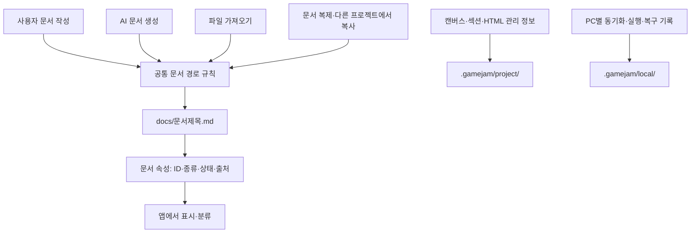
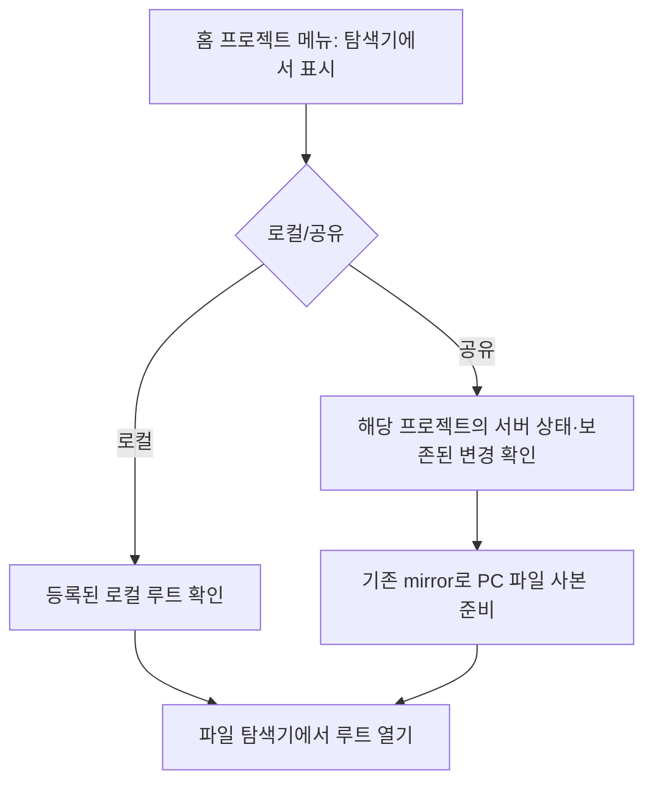

# 프로젝트 파일 구조 정리와 공유 프로젝트 탐색기 접근 구현 계획

- 작성일: 2026-10-30
- 상태: 2026-10-31 구현 및 관련 검증 완료. 실자료 이전·배포 미실행.
- 근거: 사용자와의 프로젝트 폴더 구조 논의, 현재 아키텍처 안내와 관련 구현 확인.
- 2026-10-30 ‘구현 시작’ 지시로 작업을 시작했다. 앱 업데이트와 기존 프로젝트 전환은 분리한다.

## 1. 구현할 사용자 동작

| 요구                       | 구현 후 동작                                                                                                                      |
| -------------------------- | --------------------------------------------------------------------------------------------------------------------------------- |
| 사용자 문서 저장 위치 통합 | 직접 작성·AI 생성·외부 가져오기·프로젝트 내 복제·다른 프로젝트에서 복사한 문서를 모두 `docs/` 바로 아래에 저장한다.               |
| 속성으로 문서 분류         | 종류·상태·출처·태그 등은 문서 frontmatter에 보관한다. 생성 방식으로 폴더를 만들지 않는다. 기존 속성과 알 수 없는 속성도 보존한다. |
| 빈 프로젝트로 시작         | 로컬·공유 프로젝트 모두 빈 캔버스로 시작한다. `project.md`와 기본 아이디어 문서를 자동 생성하거나 다시 만들지 않는다.             |
| 내부 관리 정보 분리        | HTML 카드 관리 정보·섹션 구성·캔버스 상태·AI 작업 기록·히스토리·동기화 데이터를 사용자 문서와 구분해 관리한다.                    |
| 공유 프로젝트 탐색기 접근  | 홈의 공유 프로젝트 메뉴에서도 ‘탐색기에서 표시’를 사용할 수 있다. 해당 PC의 프로젝트 작업용 사본 루트를 연다.                     |
| 기존 자료 보존             | 기존 프로젝트를 열어도 문서 내용·ID·배치·링크·이미지 참조·AI 결과 연결·복구 기록이 유지된다.                                      |

‘아이디어’ 기능을 제거하는 요구가 아니다. 사용자가 직접 만든 아이디어도 일반 Markdown 문서로 저장하고, 필요하면 종류 속성을 사용한다.

## 2. 확정한 방향과 추가 제안의 구분

확정한 방향은 `docs/` 통합, 속성에 의한 분류, 기본 문서 자동 생성 제거, 내부 정보 분리, 공유 프로젝트의 탐색기 접근이다.

다음은 앞선 설명에서 제안한 세부안이며, 현재 구현으로 오인하지 않는다.

- 내부 폴더의 이름은 `.gamejam/`을 권장한다. 이름 자체는 사용자 필수 요구가 아니며 아래는 이 이름을 사용한 설계안이다.
- 제목 기반 파일명과 충돌 시 짧은 ID 접미사를 권장한다. 제목 편집 때마다 파일을 자동 이동하는 기능은 포함하지 않는다.
- 앞선 예시에서는 `output/<결과이름>/<버전>/`을 제시했지만, 현재 HTML 경로에는 분류 단계가 있다. 이번 기본 범위에서는 `output/<분류>/<결과이름>/<버전>/`을 유지한다. HTML 분류 제거와 기존 결과물 버전 재정리는 별도 범위로 둔다.
- 이미지 원본의 기존 `assets/images/`는 유지한다. 오디오 등 새 가져오기 형식, 새 태그 편집기·필터 UI, 탐색기에서의 임의 파일 이동 동기화, 캐시 자동 청소는 이번 요구에 추가하지 않는다.
- 공유 프로젝트의 UUID 저장 루트·서버 저장소·호스팅 위치는 변경하지 않는다. 탐색기 접근 기능으로 현재 위치를 찾기 쉽게 한다.

## 3. 제안하는 목표 구조

```text
프로젝트 루트/
├─ docs/                         사용자가 읽고 편집하는 Markdown
│  ├─ 게임-개요.md
│  ├─ 심사-규칙.md
│  ├─ 회의-메모.md
│  └─ 심사-규칙-a1b2c3d4.md      제목 충돌 시 예시
├─ assets/
│  └─ images/                    원본 이미지
├─ output/
│  └─ <분류>/<결과이름>/v001/    현재 HTML 실행·버전 규칙 유지
│     ├─ index.html
│     └─ 관련 CSS·JS·이미지
└─ .gamejam/                     앱 내부 데이터
   ├─ project/                   공유·이전 대상인 프로젝트 관리 자료
   │  ├─ metadata.json           이름·레이아웃 버전 등
   │  ├─ canvas/                 캔버스·그림·게임 UI·상태
   │  ├─ sections/               섹션 구성 정보
   │  ├─ html/                   HTML 카드 관리 정보
   │  └─ ai/                     공동 AI 작업 명세·기록
   └─ local/                     해당 PC의 실행·복구·동기화 자료
      ├─ history/                로컬 변경 기록·AI 실행 입력/작업 사본
      ├─ previews/               개인 미리보기 창 설정
      ├─ sync/                   server-cache.json·내용 blob·미전송 변경
      └─ migrations/             이전 진행·재시작 복구 기록
```

세부 경로는 구현 시작 시 ADR과 경로 계약으로 고정한다. 빈 내부 하위 폴더는 기능이 필요할 때 생성한다. `project/`도 임의의 파일을 통째로 서버에 올리는 폴더가 아니다. 공유 허용 경로와 형식은 명시적으로 검증한다. 인증 정보는 기존 OS 암호화 저장소에 유지한다.

캔버스 그림과 게임 UI의 JSON은 사용자 작업의 실제 저장 데이터다. 내부 폴더에 있다는 이유로 재생성 가능한 캐시로 취급하지 않는다. 동기화 폴더의 미전송·오프라인 변경도 보존 대상이다.



## 4. 문서 생성·속성 규칙

1. 새 사용자 문서의 경로는 공통 규칙으로 계산한다. 파일명은 Windows 금지 문자·예약 이름·대소문자 충돌·길이를 검사하고, 충돌하면 짧은 식별자를 붙인다. 동일 명령 재시도에는 같은 할당을 사용한다. 공유 명령의 실제 충돌 판정은 서버가 최종 확정한다.
2. 문서의 영구 ID와 파일 경로를 구분한다. 제목 변경은 우선 속성과 화면 제목만 바꾸고, 파일명을 자동 변경하지 않는다. 무제목 문서도 생성 가능한 기본 이름을 제공한다.
3. `docs/imported/`, `docs/copy-.../`, `ideas/` 같은 생성 경위별 새 경로를 중단한다. 사람이 편집하는 이미지 설명 카드·게임 UI 설명 문서도 `docs/`에 저장한다.
4. AI 문서도 바로 `docs/`에 저장한다. 입력 단계에서 정한 문서 제목을 파일명에 사용하고, 문서 역할·묶음 ID·출력 key는 기존 계약과 연결해 속성으로 보관한다. AI가 허용된 출력 경로 밖에 파일을 쓰도록 범위를 넓히지 않는다.
5. AI의 ‘기존 문서 갱신’은 기존 경로를 사용한다. ‘새 문서 버전’은 `docs/versions/`를 만들지 않고 `docs/` 안에 충돌 없는 별도 파일로 생성한다. 버전·원본 관계는 속성으로 연결한다. 예: `심사-규칙-v2.md`.
6. 기존 `document_bundle_id`, `document_output`, 시스템 문서 연결 계약을 활용한다. 현재의 `game-overview`, `document-d1` 등 파일명 규칙만으로 문서 묶음을 식별하는 경로는 속성 기반으로 변경하고 구형 자료를 읽는 호환 경로를 둔다.
7. 문서 속성은 기존 모델을 확장하는 최소 범위로 정의한다. 생성 출처는 직접 작성·AI 생성·외부 가져오기·프로젝트 복사 등을 기록할 수 있게 하고, 기존 문서의 출처를 근거 없이 추정해 채우지 않는다. 기존 `sources`의 자료 참조 의미와 생성 출처를 혼용하지 않는다.
8. HTML 카드 ID·좌표·원본 경로처럼 앱 관리만을 위한 문서는 `docs/` 목록에서 분리한다. 기능이 사용자에게 작업 명세를 보여줘야 하는 경우에도 기존 UI를 통해 접근할 수 있게 한다.

## 5. 빈 프로젝트 시작

- `initialProjectSnapshot`과 로컬 layout 준비, 공유 직접 생성이 모두 자동 문서 없는 초기 상태를 사용한다.
- 프로젝트 이름은 독립 메타데이터로 관리한다. 프로젝트 이름 조회·이름 변경·생성·모드 전환·다시 열기가 `project.md`의 존재를 요구하지 않게 한다.
- 파일 사본 준비나 ‘탐색기에서 표시’를 실행해도 기본 문서가 생기지 않아야 한다.
- 기존 `project.md`는 사용자 내용이 있을 수 있으므로 자동 삭제하지 않는다. 기존 사용자 문서로 `docs/`에 이전하고 ID·내용·링크를 유지한다. 새 프로젝트에서만 생성을 중단한다.
- 앱이 생성하는 폴더 사용 안내는 사용자 문서·캔버스 항목에 섞이지 않게 내부 도움말로 옮긴다. 기존 안내 파일도 사용자가 수정했을 가능성을 고려해 무조건 삭제하지 않는다.

## 6. 기존 프로젝트 이전과 협업 호환

단순 파일 rename만으로 완료할 수 없다. 문서 경로가 링크·섹션·AI 계약·히스토리와 연결되어 있어 다음 순서를 하나의 복구 가능한 작업으로 묶는다.


- 레이아웃 버전과 `기존 경로 → 새 경로` 표를 기록한다. 준비·서버 확정·로컬 확정 단계를 구분하고, 중단 후 같은 작업을 다시 실행해도 중복 파일을 만들지 않는다.
- `ideas/*.md`, 사용자 작성 `project.md`, `docs/imported/*.md`, `docs/copy-.../*.md`, `docs/ui/*.md`, `docs/versions/...`의 사용자 문서를 `docs/`로 통합한다. 이미 `docs/`에 있는 정상 문서는 불필요하게 이름을 바꾸지 않는다.
- `.canvas`, `sections`, `.ai/tasks`, HTML 관리 문서, `.history`, 동기화 파일은 각 소유권에 맞는 내부 위치로 이전한다. 내부 Markdown의 의미를 바꾸거나 JSON으로 일괄 재작성하는 작업은 필요 범위를 확인해 제한한다.
- 본문과 알 수 없는 frontmatter, 문서 ID·작성자·좌표·크기·캔버스 소속·상태를 보존한다. 제목이 같은 문서를 덮어쓰지 않는다.
- 경로형 문서 링크, 문서 간 `sources`, 섹션 구성원, 이미지 상대 링크, 게임 UI 설명 경로, AI 입력·예상 출력·문서 묶음·결과 연결, 칸반 등 실제 참조 필드를 갱신한다. 본문 전체를 무차별 문자열 치환하지 않는다.
- 기존 히스토리 원문과 AI 실행 입력은 당시 기록으로 보존한다. 복원·Undo/Redo 시 예전 경로를 현재 경로로 해석하는 규칙을 추가해, 예전 폴더가 다시 생기거나 같은 문서가 이중 생성되지 않게 한다.
- 이전은 현재 저장·명령·프로젝트 세션·서버 FIFO·revision·receipt·원자 반영·복구 경로를 사용한다. 여러 저장 계층을 단일 원자 트랜잭션이라고 주장하지 않는다.
- 활성 AI 작업·예약 출력·잠금·미완료 저장과 이전이 동시에 실행되지 않게 한다. 공유 프로젝트의 미전송·오프라인 변경이 있으면 먼저 기존 절차로 해소하거나 이전을 보류한다. 동기화되지 않은 내용을 지우지 않는다.
- 공유 프로젝트 이전은 권한을 가진 주체가 서버 명령으로 한 번 확정한다. 다른 PC는 확정된 경로와 버전을 받아 자기 사본을 반영한다. 각 PC가 독자적으로 공동 파일 이름을 정하지 않는다.
- 서버·클라이언트가 새 레이아웃을 지원하는지 명시적으로 확인한다. 구버전 클라이언트가 이전 뒤 옛 경로에 다시 쓰지 못하게 하고, 지원하지 않는 서버에는 새 형식을 보내지 않는다. 지원 불가 상태는 업데이트 필요/이전 보류로 표시하며 조용히 이중 쓰기하지 않는다.
- 로컬의 외부 파일 변경, 디스크 오류, 서버 확정 직후 종료, 사본 반영 실패에 대한 복구를 설계한다. 서버 확정 전에는 원본을 보존하고, 확정 뒤에는 기록된 새 상태로 복구를 이어간다.
- Project-PP 실자료는 자동 수정하지 않는다. 구현 검증은 별도의 사본·임시 서버·격리 프로필에서 먼저 수행한다.

## 7. 공유 프로젝트 ‘탐색기에서 표시’

현재 홈 메뉴의 ‘저장 위치 보기’와 `ProjectHomeService.reveal`은 로컬 프로젝트만 지원한다. 작업 화면에는 이미 ‘프로젝트 폴더 열기’가 있고, 공유 사본 준비를 기존 mutation 큐에서 실행한다. 이 경로를 재사용·확장한다.



- 홈에서 로컬·공유 모두 같은 의미의 메뉴를 제공하고 공유 프로젝트의 기존 ‘서버 주소 변경’ 메뉴도 유지한다.
- 작업 화면의 기존 폴더 열기와 동작을 맞춘다. 다른 프로젝트 폴더를 표시하는 과정에서 현재 작업 프로젝트를 몰래 전환하지 않는다.
- 온라인이면 확인한 서버 상태와 PC의 보존된 변경을 기존 경로로 반영한다. 사본 준비에 실패하면 오류를 표시하고 완료로 처리하지 않는다.
- 오프라인에서는 유효한 PC 사본과 캐시가 있으면 해당 사본을 열고 최신 서버 상태를 확인하지 못했다는 상태를 알린다. 사본이 없으면 연결이 필요하다고 안내한다. 미전송 변경을 오래된 서버 자료로 덮어쓰지 않는다.
- 프로젝트 ID·실제 root·요청 대상·현재 세션을 작업 시작 시 고정한다. 삭제·휴지통·프로젝트 전환·권한 상실·늦은 응답을 확인하고 다른 폴더를 열지 않게 한다.
- 파일 사본을 보는 기능에 관리자 전용 서버 변경 권한을 요구하지 않는다. 이미 가진 자료 접근 권한과 데스크톱 파일 접근 능력을 구분한다. 웹 등 미지원 환경은 기존 runtime capability 기준을 사용한다.
- 탐색기에서 편집한 파일을 즉시 서버에 올리는 새 동작은 추가하지 않는다.

## 8. 책임 배치와 주요 변경 지점

| 책임                                      | 배치          | 확인한 대표 변경 대상                                                                                         |
| ----------------------------------------- | ------------- | ------------------------------------------------------------------------------------------------------------- |
| 공통 레이아웃·문서 속성·지원 버전 계약    | `contracts`   | 프로젝트·문서·AI 출력 계약, 공유 envelope/기능 협상                                                           |
| 파일명·충돌·경로표·참조 해석 계산         | `core`        | 새 공통 경로 규칙, 기존 `result-name`, 문서 출력·참조 계산                                                    |
| 생성·이전·실패 복구·탐색기 준비 순서      | `application` | `editing/creation-service`, `projects/home-service`, `editing/shared-project-mirror`, 프로젝트 세션·모드 전환 |
| 파일 읽기·쓰기·레이아웃·이전 기록         | `adapters`    | `filesystem/project-layout`, `home-projects`, `project-mode-files`, 문서 저장소                               |
| 서버 권한·확정·중복 처리·구버전 쓰기 차단 | `server`      | 기존 공동 명령·상태·히스토리·프로젝트 생성 경로                                                               |
| OS 탐색기·프로필 경로·실행 조립           | `desktop`     | `project-paths`, `projects/shared-projects`, IPC, `main.ts` 조립                                              |
| 메뉴·상태·오류 표시                       | `ui`          | `ProjectHome`, 기존 작업 화면 폴더 열기·AI 문서 선택 UI                                                       |

현재 루트 구현 중 함께 확인할 항목: `file-assets.ts`, `project-copy.ts`, `collaboration-model.ts`, `document-output.ts`, `document-bundle.ts`, `document-format.ts`, `html-source.ts`, `project-store.ts`, `project-metadata.ts`, `client-cache.ts`, `task-plan.ts`, `ai-file-lock.ts`.

기존 루트 파일 전체를 이번 작업에서 재구성하지 않는다. 새 규칙의 소유 계층을 정하고 기존 호출부를 연결한다. `src/shared.ts`에 새 호환 재수출을 추가하지 않는다.

## 9. 구현 순서

| 순서 | 작업                                       | 해당 단계 완료 기준                                                                            |
| ---- | ------------------------------------------ | ---------------------------------------------------------------------------------------------- |
| 1    | ADR·경로 계약·이전 규칙 작성               | 소유권, 호환 버전, 새 문서 이름과 이전 경로표, 보류·복구 조건이 명확함                         |
| 2    | 구형/신형 읽기와 복구 기반 준비            | 기존 프로젝트를 손상 없이 읽고 이전 작업을 재개할 수 있음. 새 형식 쓰기는 아직 활성화하지 않음 |
| 3    | 빈 시작과 모든 문서 생성 경로 통합         | 로컬·공유·AI·가져오기·복제·프로젝트 복사 모두 공통 저장 규칙과 출력 검증 사용                  |
| 4    | 내부 데이터 분리와 기존 프로젝트 이전 연결 | 참조 갱신·서버 확정·사본 반영·Undo/복구가 함께 동작함                                          |
| 5    | 공유 프로젝트 탐색기 메뉴 연결             | 온라인·오프라인·사본 없음·실패·세션 변경 경로 검증                                             |
| 6    | 통합·패키지 검증과 설계 문서 갱신          | 아래 완료 기준 충족, 기존 자료 회귀 없음                                                       |

단계는 하나의 변경 묶음 안에서 수행하는 순서다. 생성기만 먼저 바꾸고 기존 서버 검증·AI 출력 검증·복구가 새 경로를 이해하지 못하는 중간 상태를 배포하지 않는다.

## 10. 검증과 완료 기준

### 동작 검증

- 새 로컬·공유 프로젝트를 생성하고 다시 열거나 폴더 표시를 해도 캔버스에 자동 문서가 나타나지 않는다.
- 직접 작성, AI 문서, MD 가져오기, 이미지 설명, 게임 UI 설명, 복제, 프로젝트 간 복사 결과가 모두 `docs/`에 저장된다.
- 같은 제목·한글·금지 문자·대소문자 충돌·명령 재시도·동시 생성에서도 덮어쓰기와 이중 생성이 없다.
- AI 문서 묶음·새 버전·기존 갱신·출력 검증·입력 잠금·예약·결과 반영이 정상이다. 실제 유료 호출 대신 기존 mock CLI를 사용한다.
- 기존 프로젝트 이전 뒤 본문·ID·속성·배치·섹션·이미지·문서 링크·결과물·작성자 정보가 유지된다.
- 이전 중 종료·재시작·서버 응답 유실·디스크 실패·외부 수정·미전송 변경·구버전 접속을 검증한다.
- Undo/Redo·과거 복원·공유/로컬 모드 전환·휴지통/복원 뒤에도 새 레이아웃과 연결이 유지된다.
- 공유 프로젝트 탐색기 메뉴가 올바른 PC 루트를 열며, 다른 프로젝트로의 전환·오프라인·권한 변화·사본 없음 오류를 올바르게 처리한다.

### 검사 선택

- TypeScript: `npm run typecheck`; contracts/core 변경 시 `npm run typecheck:contracts`, `npm run typecheck:core`.
- 자동 회귀: `npm test`에 아키텍처 검사가 포함되므로 같은 소스의 `npm run test:architecture`를 중복 실행하지 않는다. 부분 검사만 실행하는 개발 단계에서는 별도로 실행한다.
- 독립적인 타입·lint·자동 검사는 병렬 실행할 수 있다. 같은 출력 폴더를 쓰는 빌드·UI·패키지 검사는 순서를 지킨다.
- 관련 기존 단위 검사: `project-home`, `project-paths`, `project-modes`, `project-files`, `project-copy`, `document-links`, `gamejam-validation`, `ai-file-lock` 및 캐시·협업·AI 검사. 경로 이전·복구용 검사를 추가한다.
- 실제 기능 검사: `npm run test:integration`, `npm run test:project-session`, `npm run test:document-links:ui`, `npm run test:gamejam-validation`, `npm run test:gamejam-history` 등 변경 경로에 해당하는 기존 절차.
- 실제 Windows 패키지: `tests/projects-packaged.mjs`, `tests/project-modes-packaged.mjs`, `tests/project-mirror-packaged.mjs`, `tests/project-copy-packaged.mjs`, `tests/document-links-packaged.mjs`, `tests/ai-queue-packaged.mjs`의 관련 시나리오를 확장·선택한다. 홈 메뉴의 실제 shell 호출과 재시작 복구를 격리 환경에서 확인한다.
- 검사 실패를 통과시키기 위해 규칙을 완화하거나 예외 목록을 재생성하지 않는다. 새로운 아키텍처 예외를 기본 해결책으로 사용하지 않는다.

책임·공개 경로 계약·저장/복구 정책 변경은 구현과 함께 ADR 및 `project-files`, `project-home`, `project-mode-transitions`, AI·협업·회귀 문서의 해당 부분을 갱신한다.

## 11. 현재 작업 상태

- 구현 결정과 실제 경로는 [ADR 0003](../architecture/decisions/0003-project-file-layout.md)에 기록했다. 내부 snapshot 식별 경로는 보존하고 filesystem adapter에서 실제 .gamejam 위치로 변환한다.
- 새 문서·빈 시작·명시적 전환·공유 탐색기 기능과 기존 히스토리/오프라인 초안/저장 큐의 경로 재연결을 구현했다.
- 앱 업데이트·프로젝트 열기만으로 기존 프로젝트를 전환하지 않는다. 관리자가 설정의 ‘프로젝트 파일 구조 정리…’에서 공유 전환을 실행한다. 구버전 앱은 전환된 프로젝트에 쓰기 전에 업데이트해야 한다.
- 작업 트리에 있던 기존 AI 공급자 관련 변경을 보존했다. 새 아키텍처 예외나 검사 규칙 완화는 추가하지 않았다.
- 배포와 Project-PP 실자료 이전은 현재 실행 범위가 아니다.

### 실행한 검증 (2026-10-31 완료)

- `npm test`: 1,058개 중 1,057개 통과, 실패 0, 기존 skip 1. 마지막 서버 히스토리 잠금 보강 후 `project-layout`/`server-history` 23개도 통과했다.
- `typecheck`, `typecheck:contracts`, `typecheck:core`, `test:architecture` 통과. 마지막 production 소스로 `typecheck`와 Windows `package`를 완료했다.
- 실제 production IPC 통합 runner 통과: 문서 저장·가져오기·AI mock CLI·히스토리·공동 편집·캔버스·그림·게임 UI·휴지통. 유료 AI 호출은 사용하지 않았다.
- 마지막 Windows 패키지에서 `projects-packaged`, `project-mirror-packaged`, `project-modes-packaged`, `project-copy-packaged`, `document-links-packaged` 통과. 실제 설정 대화상자/홈 탐색기 메뉴, 명시적 전환 후 재시작, 결과 이동·개인 설정·Undo/Redo, OS 폴더 선택, 소유권 인계/모드 전환, 로컬↔공동 및 공동↔공동 복사, 링크 복원을 확인했다.
- `run-sync-ui` 통과: 충돌 초안 보존, 저장 지연/팀원 갱신 중 한글 입력·포커스·IME·배치 유지.
- 변경 파일의 oxlint/oxfmt 및 diff 공백 검사를 통과했다. 전체 `npm run lint`의 포맷 단계는 작업 전부터 있던 `docs/plans/2026-10-29-ai-fast-modes.md`의 포맷 문제로 실패해 해당 문서를 임의 수정하지 않았다.
- 전체 `test:integration`은 기존 `canvas-sheets-ui`의 문서 컨텍스트 메뉴 표시 대기에서 중단된다. 분리한 기존 릴리스 `c4d10b7`에서도 동일하게 재현되어 이번 변경의 검사 규칙을 완화하지 않았다. 따라서 전체 통합 명령의 통과를 주장하지 않는다. 해당 명령의 production IPC/HTML/포인터 잠금/다중 창 검사와 별도 sync UI는 통과했다.
- 설정 화면 증거: `out/test-validation/project-layout-dialog.png`. 기존 릴리스 UI 실패 증거: `out/test-validation/project-layout-baseline-canvas-failure.png`.

검증은 격리된 임시 프로젝트와 테스트 프로필만 사용했다. 설치된 앱, 운영 협업 서버, Project-PP 실자료와 다른 사용자의 PC는 변경하지 않았다.
